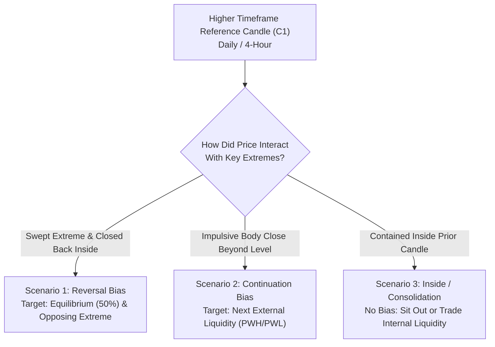
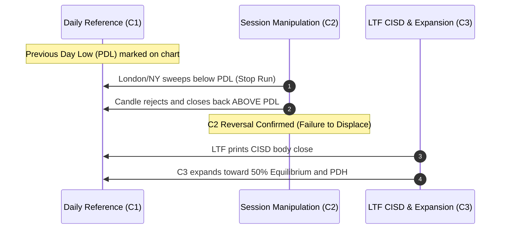
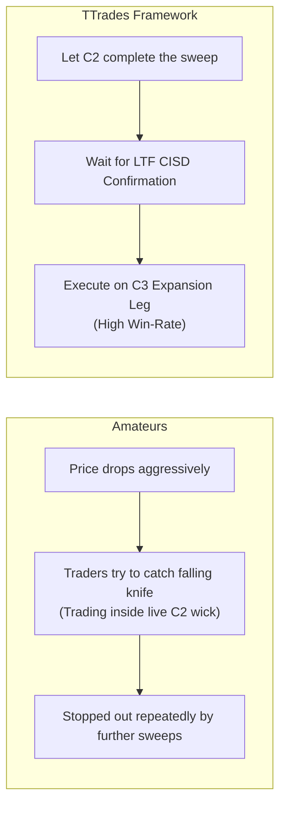
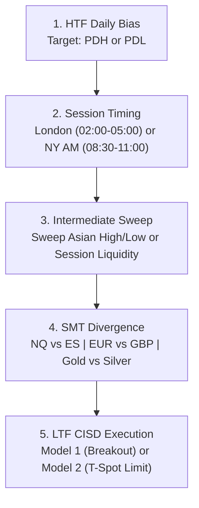

# TTrades Daily Bias & High-Probability Entry Masterclass

> **Master Reference Guide** | How TTrades Mechanically Determines Daily Bias and Executes High-Probability Entries

---

## 1. The Core Philosophy of Daily Bias

In conventional retail technical analysis, traders attempt to predict the entire path of the market using lagging indicators, moving averages, or macroeconomic theories. **TTrades strips all subjective forecasting out of the equation.**

According to TTrades, Daily Bias is **not** about predicting what every single 1-minute candle will do, nor is it about guessing market direction days in advance. 

Instead, Daily Bias answers **one single mechanical question**:

$$\text{"Is the next expansion candle seeking Buy-Side Liquidity (PDH) or Sell-Side Liquidity (PDL)?"}$$

---

## 2. The 3 Objective Anchors of Daily Bias

TTrades uses three objective price anchors to eliminate subjective guesswork:

| Anchor | Description | Institutional Function |
| :--- | :--- | :--- |
| **1. PDH & PDL** | Previous Day High and Previous Day Low | The primary **External Liquidity Pools** (resting retail stops and breakout orders). |
| **2. Equilibrium (0.50)** | The exact 50% midpoint of the prior day's range | Divides the market into **Premium (>50%)** and **Discount (<50%)**. |
| **3. Displacement vs. Sweep** | The nature of the candle closure relative to key levels | Determines whether institutional orderflow is **accepting** or **rejecting** price. |

---

## 3. The 3 Next-Day Daily Bias Scenarios

TTrades categorizes every trading day into one of three mechanical scenarios based on the prior higher-timeframe candle:

### Scenario 1: The Liquidity Sweep & Reversal (Turtle Soup)
This occurs when price raids a key high or low to engineer liquidity, but large institutions step in to reverse the delivery.

* **The Trigger**: The daily candle sweeps below the Previous Day Low (PDL) or above the Previous Day High (PDH), but **fails to displace** (its body closes back inside the prior range).
* **The Daily Bias**:
    * If PDL is swept and rejects $\rightarrow$ **Bullish Daily Bias** targeting the 50% Equilibrium and the Previous Day High (PDH).
    * If PDH is swept and rejects $\rightarrow$ **Bearish Daily Bias** targeting the 50% Equilibrium and the Previous Day Low (PDL).
* **Execution Rule**: Never short into a fresh PDL sweep, and never buy into a fresh PDH sweep.

---

### Scenario 2: The Trend Run (Displacement Continuation)
This occurs when institutional capital aggressively expands price in one direction, leaving significant imbalance.

* **The Trigger**: The prior day's candle closes with a **large, full body outside** the previous range, closing near its extreme (e.g., closing within the top 20% of its range for a bull day).
* **The Daily Bias**:
    * **Continuation Bias**: The market is in an impulsive C3 or C4 expansion leg.
    * Today's open is expected to make a shallow manipulation retracement (seeking discount or a key FVG/Orderblock), followed by aggressive expansion toward the next higher-timeframe pool (Previous Week High/Low or HTF POI).
* **Execution Rule**: Do not attempt to pick a top or bottom. Wait for the London or NY AM session to retrace to the **50% T-Spot** or an internal Fair Value Gap, then enter in the trend direction.

---

### Scenario 3: Inside Day / Consolidation (No Bias)
This occurs when market participants are in equilibrium, awaiting high-impact macroeconomic data (e.g., CPI, FOMC, NFP).

* **The Trigger**: The day's price action is entirely contained within the high and low of the previous day (Inside Bar), or the candle has tiny bodies with long wicks on both sides.
* **The Daily Bias**: **NEUTRAL / NO BIAS**.
* **TTrades Rule**: 
    > *"If there is no clear draw on liquidity, there is no bias. Cash is a position. Preserve your capital for clear expansion days."*

---

## 4. TTrades' Golden Rule: "Do Not Trade C2"

The single biggest mistake retail traders make is trying to catch the exact bottom or top while the manipulation wick is forming:

* **C2 is the Manipulation Phase**: It exists solely to trigger retail stop losses and bait breakout traders.
* **C3 is the Delivery Phase**: Once C2 closes and the lower timeframe confirms a **Change in State of Delivery (CISD)**, C3 is the high-probability expansion that delivers price to the target.

---

## 5. How to Find the Best Entries (Step-by-Step Playbook)

Once your Daily Bias is established, finding the entry follows a strict 5-step checklist:

### Step 1: Establish the Draw on Liquidity (DOL)
Before opening TradingView, look at the Daily chart:
- Where are the resting stops? (PDH, PDL, Equal Highs, Equal Lows).
- Where is the 50% Equilibrium of the current dealing range?

### Step 2: Anchor to Institutional Killzones
Price only delivers true institutional expansions during algorithmic windows (anchored to New York Time):
- **London Open (02:00 – 05:00 NY Time)**: Sets the low or high of the day for European currencies (EURUSD, GBPUSD).
- **New York AM Cash Open (08:30 – 11:00 NY Time)**: Prime delivery for US Indices (NQ, ES) and Gold.
- **Key Morning Macro (09:50 – 10:10 NY Time)**: The highest win-rate 20-minute reversal/expansion window of the day.

### Step 3: Identify the Session Sweep
In the direction opposing your daily bias, watch for a liquidity raid:
- If Bullish: Price sweeps the Asian Low or Previous Session Low during London or NY Open.
- If Bearish: Price sweeps the Asian High or Previous Session High.

### Step 4: Confirm with SMT Divergence
Check correlated asset pairs to verify institutional footprints:
- **Index Futures**: NQ makes a lower low, but ES makes a higher low (Bullish SMT).
- **Forex**: EURUSD sweeps Asian low, but GBPUSD holds above its low (Bullish SMT).
- **Precious Metals**: Gold (`XAUUSD` / `GC1!`) sweeps low, but Silver (`SI1!`) fails to sweep (Bullish SMT).

### Step 5: Choose Your Entry Model

| Entry Model | Trigger Mechanics | Entry Price | Stop Loss Placement | Best For |
| :--- | :--- | :--- | :--- | :--- |
| **Model 1: CISD Breakout** | LTF candle body closes beyond the opposing open benchmark line. | Market order at close of the CISD candle. | 1–2 ticks beyond the sweep extreme. | Fast trending markets, high momentum. |
| **Model 2: 50% T-Spot Limit** | Price displaces via CISD, then retraces into the 50% equilibrium of the sweep wick or FVG. | Limit order resting at 0.50 Equilibrium. | Beyond the sweep extreme. | Highest Risk-to-Reward (1:3 to 1:5+), calm execution. |
| **Model 3: Micro CISD Sniper** | Intra-bar micro timeframe CISD inside the higher-timeframe C2 wick. | Market/Limit on micro CISD close. | Below the micro sweep low. | Experienced scalpers on 1-minute chart. |
| **Model 4: C4 Continuation** | Shallow retracement into broken CISD line or inversion FVG after initial expansion. | Limit/Market on retest. | Below continuation swing low. | Trend runners who missed the initial reversal. |

---

## 6. Timeframe Ratio Golden Rule

To ensure your entry model does not get trapped by the 60:1 ratio disparity:

| Asset | Your Execution Chart | Your Setup / C2 Timeframe | Your Daily Bias Chart |
| :--- | :--- | :--- | :--- |
| **EURUSD / GBPUSD (Scalp)** | **1-Minute (1m)** | **15-Minute (15m)** | Daily (1D) / 4-Hour (4H) |
| **EURUSD / GBPUSD (Day Trade)** | **5-Minute (5m)** | **1-Hour (1H)** | Daily (1D) |
| **Gold (XAUUSD / GC)** | **5-Minute (5m)** | **1-Hour (1H)** | Daily (1D) / 4-Hour (4H) |
| **NQ / ES (Futures)** | **1-Minute (1m)** | **15-Minute (15m)** | Daily (1D) / 1-Hour (1H) |

---

## 7. Daily Pre-Market Routine Checklist

Print this checklist or keep it open beside your trading station:

- [ ] **1. Mark Yesterday's Extremes**: Draw horizontal lines at **PDH**, **PDL**, and calculate the **50% Equilibrium**.
- [ ] **2. Check HTF Structure**: Did yesterday close as a Sweep (Scenario 1) or an Expansion (Scenario 2)?
- [ ] **3. Identify the Draw on Liquidity**: What is today's primary target? (e.g., taking out PDH).
- [ ] **4. Wait for Session Killzone**: Do not trade during the Asian session or pre-market dead zones.
- [ ] **5. Watch the Manipulation Sweep**: Observe price sweeping Asian Range or prior session liquidity.
- [ ] **6. Check SMT Divergence**: Is the correlated sister asset confirming the sweep?
- [ ] **7. Wait for LTF CISD**: A candle body MUST close across the benchmark line.
- [ ] **8. Set Limits / Execute**: Enter via Model 1 or Model 2 with stop loss firmly placed beyond the sweep low.
- [ ] **9. Take Profits Mechanically**: Scale out 50% at 50% Equilibrium, move stop to breakeven, and let the runner hit the PDH/PDL target.

