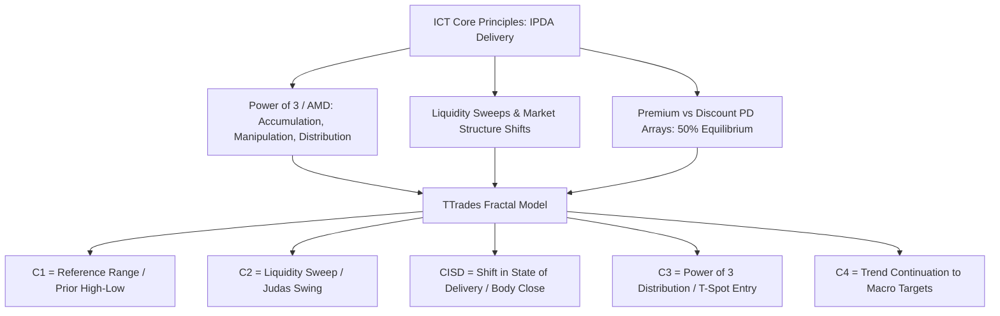

# Overview & Architecture

> **The Bridge Between Inner Circle Trader (ICT) Concepts and Algorithmic Mechanical Execution.**

---

## Is the Fractal Model Within ICT?

### Yes — 100% Founded on Core ICT Principles
The question frequently arises because **TTrades** introduced standardized terminology like **C1, C2, C3, CISD, and T-Spot**. However, the **Fractal Model is directly derived from Michael J. Huddleston's Inner Circle Trader (ICT) concepts**:

---

## Direct Conceptual Mapping

| ICT Concept | TTrades Fractal Model (TTFM) Equivalent | Mechanical Role in Trading |
| :--- | :--- | :--- |
| **Accumulation (A in AMD)** | **C1 (Candle 1)** | Establishes the initial range high and low (External Liquidity). |
| **Manipulation / Judas Swing (M in AMD)** | **C2 (Candle 2)** | Sweeps C1 high/low into a Higher Timeframe Point of Interest (HTF POI). |
| **Shift in Market Structure / Orderflow** | **CISD (Change in State of Delivery)** | Candle body close past the benchmark open price that initiated the sweep. |
| **Distribution / Expansion (D in AMD)** | **C3 (Candle 3)** | Fast directional displacement toward opposing liquidity pools. |
| **Continuation / Second Leg** | **C4 (Candle 4)** | Trend continuation to macro Standard Deviation targets (-2 to -4.5). |
| **Optimal Trade Entry (OTE / 50-62%)** | **T-Spot (50% Equilibrium Box)** | 50% midpoint of the manipulation leg or C2 wick. |
| **Intermarket Divergence (SMT)** | **SMT Confluence Filter** | Correlated asset failure to sweep C2 low/high (e.g. NQ lower low vs ES higher low). |

---

## The 4 Golden Rules of the Framework

!!! tip "Rule 1: Time Dictates Price"
    Trades are only valid during institutional liquidity killzones:
    
    - **London Open**: 02:00 – 05:00 NY Time (07:00 – 10:00 London Time)
    - **New York AM**: 08:30 – 11:00 NY Time
    - **Key Morning Macro**: 09:50 – 10:10 NY Time
    - **New York PM**: 13:30 – 16:00 NY Time

!!! warning "Rule 2: Candle Body vs. Wick"
    - **Wicks do the damage (sweeps)**: Wicks take liquidity and trigger traps.
    - **Bodies tell the truth (delivery)**: Trend shifts and CISD are **ONLY** valid when the candle body closes through the benchmark level.

!!! example "Rule 3: Higher Timeframe Determines the Direction"
    Never trade a Lower Timeframe (LTF) signal in isolation. If the 4H or 1H candle is currently forming its C2 manipulation wick, you only look for LTF entries in the direction of the expected C3 expansion.

!!! note "Rule 4: Standard Deviation Targets Remove Emotion"
    Targets are mathematically anchored using Fibonacci extensions from the C2 manipulation low to the CISD high:
    
    - **TP1**: -1.0 Extension (Opposing Session Liquidity / BSL / SSL)
    - **TP2**: -2.0 to -2.5 Extension (Standard Macro Expansion)
    - **Runner**: -4.0 to -4.5 Extension (Complete HTF Delivery Cycle)
