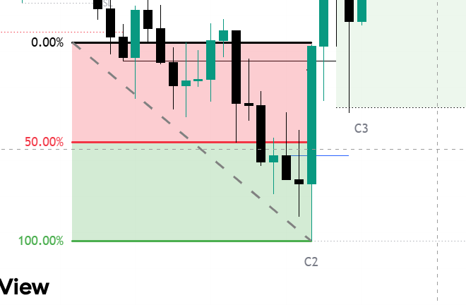

# Chapter 01: Foundational Concepts & Market Delivery

> **Core Curriculum** | Next: [Chapter 02: The C1–C2–C3–C4 Fractal Sequence](02_fractal_sequence.md)

---

## 1. The Core Philosophy of Market Delivery

The TTrades Fractal Model is predicated on the foundational tenet that **financial markets do not move randomly; they deliver price algorithmically based on liquidity and orderflow imbalances**.

### "Wicks Do the Damage, Bodies Tell the Story"
This ICT maxim is the bedrock of candle interpretation in the Fractal Model:

* **The Body (`Close` vs `Open`)**: Represents true institutional volume and conviction. Where the candle body closes tells you whether algorithmic delivery was accepted or rejected at that price level.
* **The Wick (`High` and `Low`)**: Represents liquidity probes, sweeps, and stop hunts. A wick extending past a level without candle body acceptance indicates orders were filled and price was immediately rejected.

```
          BULLISH SWEEP (REVERSAL)             BULLISH ACCEPTANCE (EXPANSION)
                 High                                      High
                  │                                         │
               ┌─────┐                                   ┌─────┐
               │Close│                                   │Close│
               │     │                                   │     │
               │Open │                                   │Open │
               └─────┘                                   └─────┘
                  │                                         │
        ══════════╪═════════ Prior Low           ───────────┼─────────── Prior High
                  │ (Wick sweeps liquidity)                 │ (Body closes above)
                 Low                                       Low
```

---

## 2. Sweeps vs. Closes: Determining Market Intent

When price reaches an established swing high, session boundary, or key level, it can only interact in one of two ways:

| Price Action Behavior | Signature on Chart | Market Meaning | Expected Next Move |
| :--- | :--- | :--- | :--- |
| **Liquidity Sweep** | Wick pierces the level, but the **body closes back inside** the prior range. | Liquidity was purged; opposing institutional limit orders were triggered. | **Reversal** back toward the opposite side of the dealing range. |
| **Expansion Run (Breakout)** | Candle **body closes clearly beyond** the prior high/low level. | Acceptance; new dealing range initiated; orderflow supports trend continuation. | **Continuation** toward next HTF liquidity pool. |

---

## 3. Dealing Ranges & The 50% Equilibrium (0.5) Principle

Every trade setup exists inside an active **Dealing Range** (the swing high and swing low defining current price delivery).

### Visualizing the 50% Equilibrium Box
Here is an authentic capture of the indicator calculating the exact **50.00% Equilibrium** between the prior swing and the C2 manipulation low:


<div class="image-caption">Figure 1.3: Real chart showing the 50.00% Equilibrium line separating Premium (Red) and Discount (Green) with C2 sweep and C3 entry box.</div>

### The Mathematical Formula:
```pinescript
Equilibrium = (Dealing_Range_High + Dealing_Range_Low) / 2
```

* **Traditional ICT View**: Buy in Discount (< 50%), Sell in Premium (> 50%).
* **TTrades Nuance**:
    * During strong institutional expansions, price **respects the 50% equilibrium line**.
    * If a bullish displacement fails to close below 50% of the manipulation leg, the institutional orderbook remains fiercely protected by buyers.

---

## 4. Internal vs. External Liquidity Delivery (ERL to IRL)

Price perpetually cycles between two states:

1. **External Range Liquidity (ERL)**:
    * Swing highs, swing lows, session extremes (Previous Day High/Low, London Session High/Low, Asian Session High/Low).
    * Once ERL is purged via a sweep, price seeks **Internal Range Liquidity (IRL)**.
2. **Internal Range Liquidity (IRL)**:
    * Fair Value Gaps (FVG), Balanced Price Ranges (BPR), and Orderblocks inside the range.
    * Once IRL is rebalanced/mitigated, price spools back to seek opposing **ERL**.

!!! summary "The Master Cycle Formula"
    We wait for an **ERL sweep** (forming a C2 candle), look for mitigation inside an **IRL Point of Interest** (the T-Spot / FVG), and ride the **C3 expansion** into opposing ERL.
