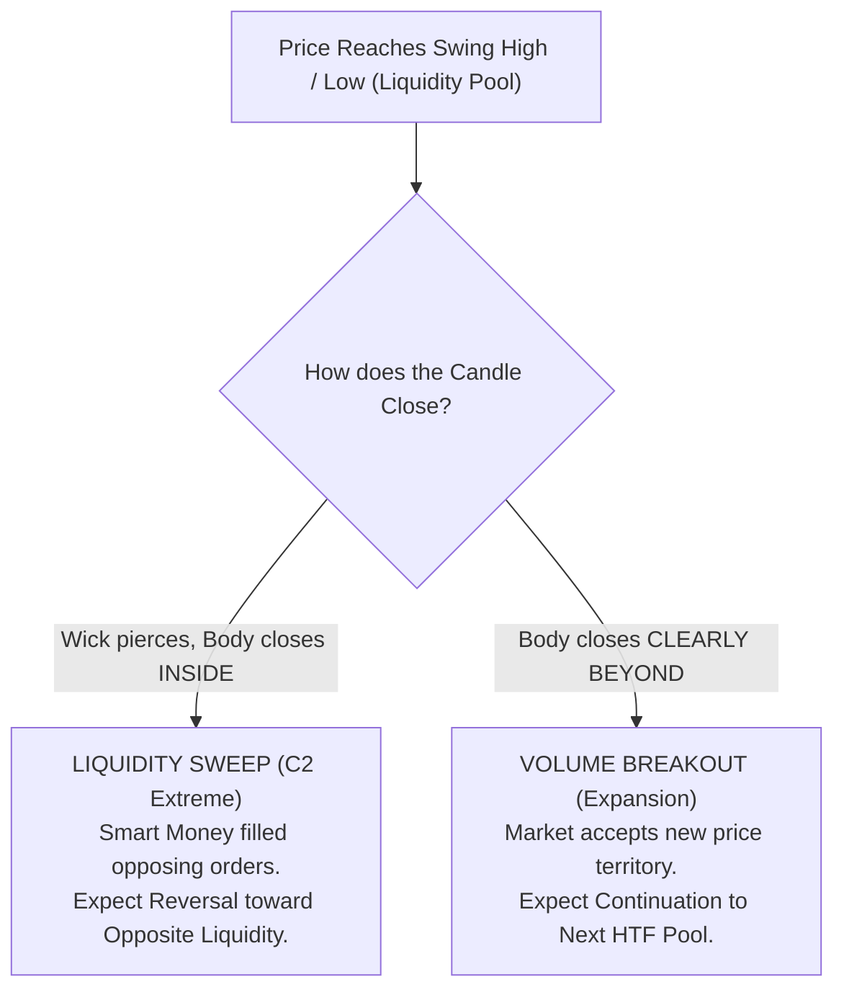

# Chapter 01: Foundational Concepts & Market Delivery

> **Core Curriculum** | Next: [Chapter 02: The C1–C2–C3–C4 Fractal Sequence](02_fractal_sequence.md)

---

## 1. The Core Philosophy of Market Delivery

The TTrades Fractal Model is predicated on the foundational tenet that **financial markets do not move randomly; they deliver price algorithmically based on liquidity and orderflow imbalances**.

### "Wicks Do the Damage, Bodies Tell the Story"
This ICT maxim is the bedrock of candle interpretation in the Fractal Model:

* **The Candle Body (`Close` vs `Open`)**: Represents true institutional volume and conviction. Where the candle body closes tells you whether algorithmic delivery was accepted or rejected at that price level.
* **The Candle Wick (`High` and `Low`)**: Represents liquidity probes, sweeps, and stop hunts. A wick extending past a level without candle body acceptance indicates orders were filled and price was immediately rejected.

| Metric | Liquidity Sweep (Reversal) | Volume Acceptance (Expansion) |
| :--- | :--- | :--- |
| **Candle Wick** | Pierces past key swing high or low level | Traverses through the level |
| **Candle Body Close** | Closes **strictly inside** the prior range | Closes **strictly beyond** the level |
| **Algorithmic State** | Liquidity purged, orderbook filled against retail | Orderbook accepts higher/lower prices |
| **Actionable Bias** | Look for C3 CISD reversal setup | Look for trend continuation / C4 continuation |

---

## 2. Sweeps vs. Closes: Determining Market Intent

When price reaches an established swing high, session boundary, or key level, it interacts in one of two distinct algorithmic modes:



---

## 3. Dealing Ranges & The 50% Equilibrium (T-Spot)

Every high-probability trade setup exists inside an active **Dealing Range** (the swing high and swing low defining current institutional price delivery).

### Visualizing the 50% Equilibrium Box
Below is the photorealistic chart showing the exact **50.00% Equilibrium** line separating the **Premium Sell Zone** from the **Discount Buy Zone**:


<div class="image-caption">Figure 1.1: Dealing Range breakdown showing 100% Range High (Premium), 50% Equilibrium (T-Spot), and 0% Range Low (Discount).</div>

### The Mathematical Formula:
```pinescript
Equilibrium = (Dealing_Range_High + Dealing_Range_Low) / 2
```

* **Wholesale Discount (< 50%)**: Institutional buy programs only execute when price trades below equilibrium into discount arrays (FVG, Orderblock, C2 Low).
* **Expensive Premium (> 50%)**: Institutional sell programs distribute long positions or open short positions when price trades above equilibrium.
* **TTrades Nuance**:
    * During strong institutional expansions, price **respects the 50% equilibrium line**.
    * If a bullish displacement holds above 50% of the manipulation leg, the institutional orderbook remains fiercely protected by buyers.

---

## 4. Internal vs. External Liquidity Delivery (ERL to IRL)

Price perpetually cycles between two states of liquidity:

1. **External Range Liquidity (ERL)**:
    * Major swing highs, swing lows, and session extremes (Previous Day High/Low, London Session High/Low, Asian Session High/Low).
    * Once ERL is purged via a sweep, price seeks **Internal Range Liquidity (IRL)**.
2. **Internal Range Liquidity (IRL)**:
    * Fair Value Gaps (FVG), Balanced Price Ranges (BPR), and Orderblocks inside the range.
    * Once IRL is rebalanced/mitigated, price spools back to seek opposing **ERL**.

!!! summary "The Master Execution Formula"
    We wait for an **ERL sweep** (forming a C2 candle), look for mitigation inside an **IRL Point of Interest** (the T-Spot / FVG), and ride the **C3 expansion** into opposing ERL.
