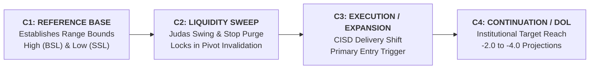

# Chapter 02: The C1–C2–C3–C4 Fractal Sequence

> **Core Curriculum** | Previous: [Chapter 01: Foundational Concepts](01_foundational_concepts.md) | Next: [Chapter 03: CISD](03_cisd_deep_dive.md)

---

## 1. Overview of the 4-Candle Lifecycle

The hallmark of the TTrades methodology is organizing market fractals into an exact sequence of **four consecutive candles**. This delivery lifecycle repeats fractally across every timeframe:

### Visual Cycle Diagram
Below is the photorealistic architectural schematic of the complete 4-candle delivery cycle:

Figure 2.1: The 4-candle delivery cycle showing C1 reference range, C2 liquidity sweep, C3 displacement & CISD, and C4 institutional distribution.

---

## 2. Candle Roles & Algorithmic Mechanics

### Candle 1 (C1) — The Reference Anchor
* **Role**: Sets the liquidity bounds and benchmark levels for the upcoming delivery cycle.
* **Key Levels Marked**:
    * `C1 High`: Buyside Liquidity (BSL) target or sweep level.
    * `C1 Low`: Sellside Liquidity (SSL) target or sweep level.
    * `C1 Equilibrium`: 50% midpoint of the candle range.

### Candle 2 (C2) — The Liquidity Sweep & Pivot Formation
* **Role**: The pivot candidate. C2 tests or purges the liquidity established by C1.
* **Bullish Setup Requirements**:
    * C2 wicks **below** the C1 Low (sweeping sellside liquidity).
    * C2 candle body **closes back inside** the C1 range or above the sweep level.
    * The lowest point of C2 becomes the **Extreme Low** (`c2_extreme`), serving as the strict stop-loss invalidation level.
* **Bearish Setup Requirements**:
    * C2 wicks **above** the C1 High (sweeping buyside liquidity).
    * C2 candle body **closes back inside** the C1 range or below the sweep level.
    * The highest point of C2 becomes the **Extreme High** (`c2_extreme`), serving as the strict stop-loss invalidation level.
* **Confirmation Rule**: C2 is only an official pivot **after it closes**. If C2 is still open, it is treated as an active unconfirmed probe.

### Candle 3 (C3) — The Execution & Expansion Candle
* **Role**: The primary execution candle. This is where Power of 3 (Accumulation-Manipulation-Distribution) delivers explosive, directional displacement.
* **Execution Rules**:
    * C3 opens and forms its initial manipulation probe.
    * Retraces into the **50% T-Spot Zone** or lower-timeframe discount FVG.
    * Confirms via a lower-timeframe **Change in State of Delivery (CISD)**.
    * Expands aggressively toward the projected target liquidity.

### Candle 4 (C4) — The Delivery & Extension Candle
* **Role**: Delivery completion, runner trailing, or continuation checkpoint.
* **Rules**:
    * C4 should not violate the extreme of C3 in a healthy institutional trend.
    * Once price reaches `-2.0` or `-2.5` standard deviations, runner targets are closed or stop loss is trailed tightly.

---

## 3. Real TradingView Chart Interface

Below is the photorealistic chart showing the complete execution of the sequence on **NQ1! (1m - 15m Model)**:

Figure 2.2: Live TradingView indicator execution showing C2 sweep, CISD benchmark ray, C3 entry, C4 extension, and HTF projection candles.

---

## 4. Summary Checklist for C1–C3

!!! example "Pre-Execution Checklist"
    - [x] **C1 Range**: Has C1 established a clear high and low?
    - [x] **C2 Sweep**: Has C2 swept C1's high/low and closed back within the range without body acceptance?
    - [x] **HTF POI**: Did the C2 sweep tap into a higher-timeframe FVG or Orderblock?
    - [x] **C3 Expansion**: Is C3 ready to expand in the direction of the reversal?
    - [x] **CISD Confirmed**: Has the candle body closed beyond the benchmark candle open?
