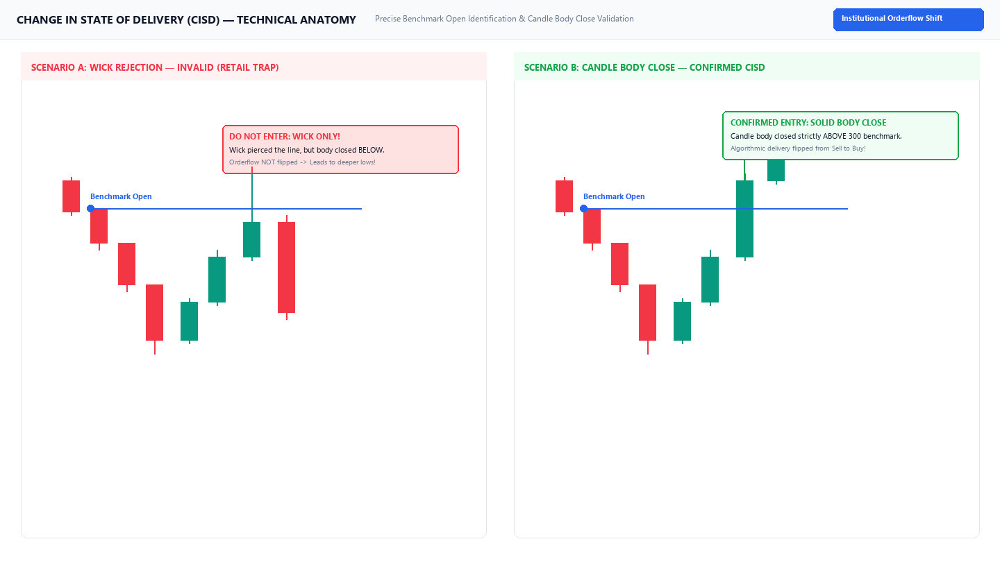
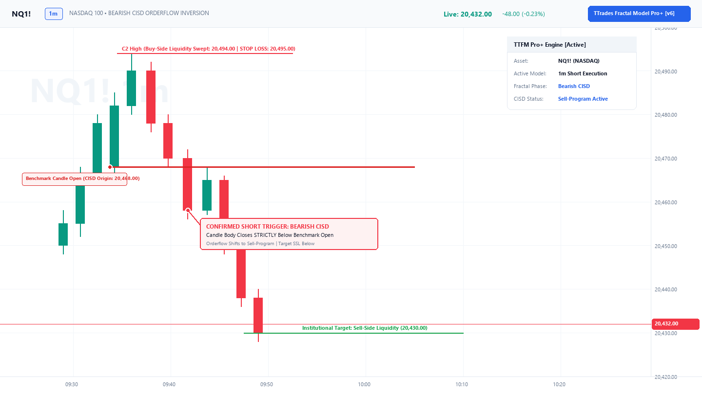
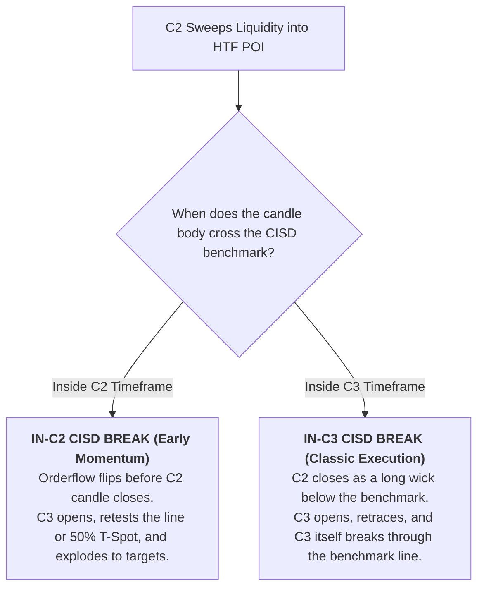

# Chapter 03: Change in State of Delivery (CISD)

> **Core Curriculum** | Previous: [Chapter 02: Fractal Sequence](02_fractal_sequence.md) | Next: [Chapter 04: POI & The T-Spot](04_poi_and_tspot.md)

---

## 1. What is a Change in State of Delivery (CISD)?

**Change in State of Delivery (CISD)** is the objective algorithmic confirmation mechanism of the TTrades Fractal Model.

In institutional market making algorithms:
* When price is dropping into a sweep, every consecutive candle is delivered under a **sell program** (bearish institutional orderflow).
* For the algorithm to legally shift into a **buy program** (bullish delivery), price must actively displace and close a candle body past the exact price origin where the final sell program initiated.
* That origin point is mathematically and visually defined as the **Open price of the first opposing candle** in the leg that created the C2 extreme.

---

## 2. Technical Anatomy: Wick Rejection vs. Body Close

The single most critical rule in the entire framework: **A wick piercing through the CISD line is NOT a valid trigger. Only a solid candle body close confirms that orderflow has flipped.**

Below is the technical deep-dive chart contrasting a retail wick trap with a true algorithmic body close:

Figure 3.1: Technical comparison — Scenario A (Wick Rejection Trap / Invalid) vs Scenario B (Solid Candle Body Close / Confirmed CISD).

---

## 3. Strict Mechanical Identification Rules

### The Golden Rule of the Benchmark Origin
!!! important "Exact Origin Coordinate of the CISD Benchmark Line"
    The CISD horizontal ray **must start visually and mathematically at the exact `Open` of the first opposing candle** that initiated the final delivery leg into the C2 extreme:
    
    * **Bullish CISD**: The ray begins at the `Open` of the *first bearish (down-close) candle* that led down into the C2 sweep low.
    * **Bearish CISD**: The ray begins at the `Open` of the *first bullish (up-close) candle* that led up into the C2 sweep high.

### Bullish CISD Step-by-Step
1. **Identify the Extreme**: Locate the lowest point formed during the C2 liquidity sweep (`c2_low`).
2. **Trace Back the Bearish Leg**: Locate the series of down-close (bearish) candles that drove price into that low.
3. **Anchor the Benchmark**: Find the *first* candle of that bearish sequence. Place the horizontal CISD ray directly at its `Open` price.
4. **Wait for Candle Close**: Monitor the execution timeframe (e.g. 1-minute chart).
5. **Trigger Validation**: The candle **body must close strictly above** this benchmark line.

### Bearish CISD Step-by-Step
1. **Identify the Extreme**: Locate the highest point formed during the C2 liquidity sweep (`c2_high`).
2. **Trace Back the Bullish Leg**: Locate the series of up-close (bullish) candles that drove price into that high.
3. **Anchor the Benchmark**: Find the *first* candle of that bullish sequence. Place the horizontal CISD ray directly at its `Open` price.
4. **Trigger Validation**: The candle **body must close strictly below** this benchmark line.

Below is the photorealistic chart showing a Bearish CISD setup executed to precision:

Figure 3.2: Bearish CISD orderflow inversion on NQ1! — showing the benchmark origin at the first green candle open and red body close trigger.

---

## 4. Early CISD vs. Confirmed CISD

In both live trading and the Pine Script indicator engine, two distinct stages of CISD exist:

| CISD State | Definition & Timing | Risk Profile | Best Use Case |
| :--- | :--- | :--- | :--- |
| **Early / Live CISD** | Triggers while C2 is **still actively forming** (intra-bar). Price sweeps C1 and breaks the opposing open before C2's HTF time closes. | Higher reward, higher risk. If C2 expands further, the level can get invalidated. | Scalpers seeking sniper entries at the HTF wick turn. |
| **Confirmed CISD** | Triggers **after C2 has officially closed** as a valid sweep. C3 opens and breaks the CISD level, or respects the already-broken level. | High probability, conservative. C2 pivot is permanently locked in. | Standard rule-based execution for consistent 70%+ win rates. |

---

## 5. In-C2 vs. In-C3 CISD Breaks

Traders frequently ask: **"Does the CISD line have to break in C2 or in C3?"**

Both sequences are completely valid and represent different timing expressions of the same underlying algorithmic flip.

---

## 6. Strict Invalidation Rules

A CISD is declared **INVALID** immediately under any of these conditions:

1. **Wick-Only Piercing**: Price wicks past the benchmark line but pulls back to close on the wrong side. **Never enter on a wick probe.**
2. **C2 Extreme Pierced**: If price breaks the CISD line but subsequently reverses and violates the C2 sweep extreme by even 1 tick, the setup is **DEAD**. Close the trade immediately.
3. **Time Degradation**: More than two higher timeframe candles elapse without directional displacement out of the CISD zone.
