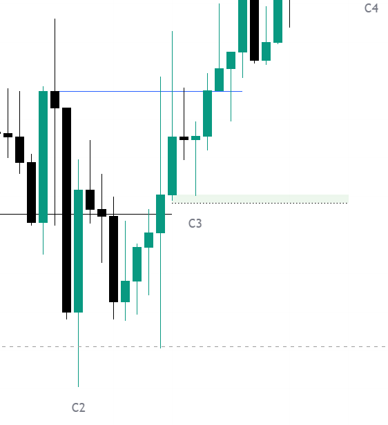

# Chapter 03: Change in State of Delivery (CISD)

> **Core Curriculum** | Previous: [Chapter 02: Fractal Sequence](02_fractal_sequence.md) | Next: [Chapter 04: POI & The T-Spot](04_poi_and_tspot.md)

---

## 1. What is a Change in State of Delivery (CISD)?

**Change in State of Delivery (CISD)** is the core algorithmic entry and confirmation mechanism in the TTrades model.

In institutional order flow:
* When price is pushing lower, every candle is delivered under a **sell program** (bearish delivery).
* For the algorithm to shift into a **buy program** (bullish delivery), it must actively close past the price origin of the last bearish delivery leg.
* That origin point is mathematically defined as the **opening price of the opposing candle(s)** that formed the sweep extreme.

```
═════════════════════════════════════════════ CISD Level (Opposing Candle Open)
                            ▲
                            │ Candle Body CLOSES ABOVE this level
                            │ (Confirms algorithmic delivery has flipped)
```

---

## 2. Visualizing the CISD Breakout Candle

Here is a close-up from an authentic TradingView chart showing the exact moment the green candle body decisively closes above the blue CISD benchmark line, triggering the shift into C3:


<div class="image-caption">Figure 3.1: Close-up chart showing the blue CISD line, the breakout candle close, and the subsequent C3 mitigation box.</div>

---

## 3. Mechanical Identification Rules

### Bullish CISD (Shift from Selling to Buying)
1. **Identify the Extreme**: Locate the lowest point formed during the C2 liquidity sweep (`c2_low`).
2. **Trace Back to Opposing Candles**: Find the last consecutive **down-close (bearish) candle(s)** that immediately led into that low.
3. **Mark the Level**: Draw a horizontal line at the **Open price** of the *first* down-close candle in that series.
4. **Trigger Condition**: Wait for a subsequent candle **body to close strictly above** this marked Open price.
5. **Validation**: Once the candle body closes above, **Bullish CISD is confirmed**.

### Bearish CISD (Shift from Buying to Selling)
1. **Identify the Extreme**: Locate the highest point formed during the C2 liquidity sweep (`c2_high`).
2. **Trace Back to Opposing Candles**: Find the last consecutive **up-close (bullish) candle(s)** that immediately led into that high.
3. **Mark the Level**: Draw a horizontal line at the **Open price** of the *first* up-close candle in that series.
4. **Trigger Condition**: Wait for a subsequent candle **body to close strictly below** this marked Open price.
5. **Validation**: Once the candle body closes below, **Bearish CISD is confirmed**.

---

## 4. Early CISD vs. Confirmed CISD

In both live trading and the Pine Script indicator, two stages of CISD exist:

| CISD State | Definition & Timing | Risk Profile | Best Use Case |
| :--- | :--- | :--- | :--- |
| **Early / Live CISD** | Triggers while C2 is **still actively forming** (intra-bar). Price sweeps C1 and breaks the opposing open before C2's HTF time finishes. | Higher reward, higher risk. If C2 expands further, the level can get invalidated. | Aggressive traders seeking tight stops right at the HTF wick turn. |
| **Confirmed CISD** | Triggers **after C2 has officially closed** as a valid sweep. C3 opens and breaks the CISD level, or respects the already-broken level. | High probability, conservative. C2 pivot is permanently locked in. | Standard rule-based execution for maximum win-rate. |

---

## 5. In-C2 vs. In-C3 CISD Breaks

A crucial question many traders ask is: **"Does the CISD line have to break in C2 or in C3?"**

!!! tip "The Answer: Both Are Valid (Two Distinct Timings)"
    
    1. **In-C2 Break (Early Momentum)**:
        - Price purges liquidity, reverses aggressively, and closes past the CISD line **before C2's timeframe ends**.
        - When C3 opens, the CISD is already confirmed! In this case, C3 opens, retraces down to retest the CISD line or 50% T-Spot, and shoots to targets.
    
    2. **In-C3 Break (Classic Execution)**:
        - C2 forms a deep sweep and closes with a long wick, but remains below the CISD benchmark.
        - C3 opens, pulls back slightly, and then **C3 itself displaces through the CISD line**.
        - This is the classic Model 1 and Model 3 sequence.

---

## 6. Invalidation Rules

A CISD is immediately declared **INVALID** if:

1. After the CISD line is broken, price reverses and **closes beyond the C2 extreme** (the swing low for bullish, swing high for bearish).
2. The candle body fails to close beyond the level (wick only = rejection, not CISD).
3. More than 2 higher timeframe candles elapse without directional displacement.
