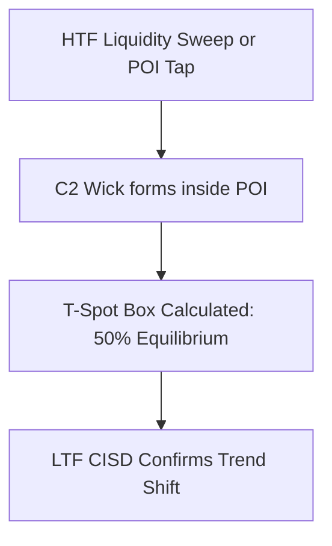

# Chapter 04: Points of Interest (POI) & The T-Spot

> **Core Curriculum** | Previous: [Chapter 03: CISD](03_cisd_deep_dive.md) | Next: [Chapter 05: Timeframe Alignment](05_timeframe_alignment.md)

---

## 1. Validating Points of Interest (POI)

A C1 sweep and C2 pivot cannot occur in a vacuum; they must interact with an institutional **Point of Interest (POI)** on a Higher Timeframe (HTF):



### High-Probability POIs in TTFM:
1. **Fair Value Gap (FVG)**:
    * 3-candle imbalance (BISI or SIBI).
    * Highest probability when C2 taps into the **Consequent Encroachment (50% CE)** of an HTF FVG.
2. **Inverse Fair Value Gap (IFVG)**:
    * A previously broken FVG that flips into supporting or resisting price.
3. **Orderblock (OB) & Breaker Block (BB)**:
    * An OB that previously formed after a liquidity run.
    * A Breaker Block that previously took liquidity before an impulsive market structure shift.

---

## 2. What is the "T-Spot"?

The **T-Spot** is TTrades' proprietary calculation representing the **exact zone where the higher-timeframe candle wick is anticipated to exhaust and reverse during the C3 expansion**.

### Mathematical Derivation of the T-Spot
The T-Spot zone is calculated by taking the relationship between:

1. **The C2 Wick Midpoint (Equilibrium)**:
    ```pinescript
    c2_wick_midpoint = (c2_high + c2_low) / 2
    ```
2. **The C3 Opening Price**:
    ```pinescript
    c3_open = open[0]  // at the start of C3
    ```
3. **The T-Spot Entry Zone**:
    * **For Bullish Setups**: The box bounded between `c3_open` and `c2_wick_midpoint` (or lower boundary down to the 50% discount of the sweep leg).
    * **For Bearish Setups**: The box bounded between `c3_open` and `c2_wick_midpoint` (or upper boundary up to the 50% premium of the sweep leg).

```
   Bullish T-Spot Schematic:
   ─────────────────────────────────────────────────── C3 Open
   ░░░░░░░░░░░░░░░░░░░░░░░░░░░░░░░░░░░░░░░░░░░░░░░░░░░
   ░░░░░░░░░░░░░░░░░ THE T-SPOT BOX ░░░░░░░░░░░░░░░░░   <-- Best Limit Entry Zone
   ░░░░░░░░░░░░░░░░░░░░░░░░░░░░░░░░░░░░░░░░░░░░░░░░░░░
   ─────────────────────────────────────────────────── C2 Wick Midpoint (50% EQ)
   
   ═══════════════════════════════════════════════════ C2 Extreme Low (Stop Loss)
```

---

## 3. Real Chart Illustration of the T-Spot Box

Here is an authentic capture showing the T-Spot equilibrium box calculated on the chart, shading the discount area green and premium area red:


<div class="image-caption">Figure 4.1: Live chart showing 0.00%, 50.00% Equilibrium (T-Spot), and 100.00% C2 swing low.</div>

---

## 4. Why Price Wicks into the T-Spot

When C3 opens, retail breakout traders often chase the move immediately. However, institutional algorithms follow the **Power of 3 (Accumulation, Manipulation, Distribution)**:

1. **Open**: C3 opens.
2. **Manipulation (Wick into T-Spot)**:
    * In a bullish setup, price drops *below* the open into discount to tap the **T-Spot** (rebalancing the micro FVG or testing the C2 wick midpoint).
    * This shakes out early breakout buyers and fills institutional long limit orders at a superior average price.
3. **Distribution (Body Expansion)**:
    * Once filled inside the T-Spot, price accelerates away from the open and closes near its extreme.

---

## 5. How the Indicator Plots the T-Spot
In our Pine Script v6 indicator (`scripts/indicators/fractal_model.pine`):

* The input option `showTSpot = input.bool(true, 'T-Spot Box')` automatically projects a colored box labeled **T-Spot** as soon as C2 closes.
* When C3 opens, the box stays fixed forward, highlighting the exact price band for placing limit orders or waiting for LTF Model 3 confirmation.
