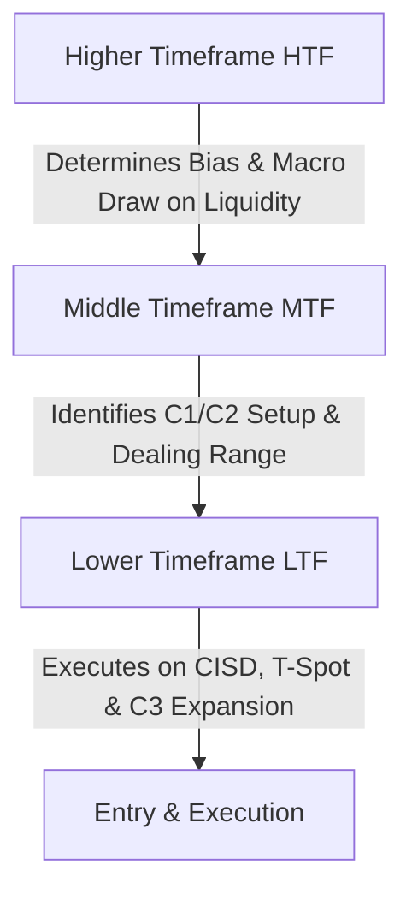

# Chapter 05: Timeframe Alignment & Bias Matrix

> **Core Curriculum** | Previous: [Chapter 04: POI & The T-Spot](04_poi_and_tspot.md) | Next: [Chapter 06: Entry Models Playbook](06_entry_models.md)

---

## 1. Top-Down Alignment Hierarchy

The Fractal Model relies on a strict **3-tier timeframe hierarchy**:



---

## 2. Standard Timeframe Pairing Matrix

To avoid chart clutter and conflicting signals, the indicator provides pre-configured model presets:

| Trading Style / Preset | Higher Timeframe (Bias) | Middle Timeframe (Setup/C2) | Lower Timeframe (Execution/CISD) | Best Session | Typical Holding Time |
| :--- | :--- | :--- | :--- | :--- | :--- |
| **1m - 15m Model** | **1-Hour (1H)** | **15-Minute (15m)** | **1-Minute (1m)** | NY AM (08:30–11:00) | 15 – 45 minutes |
| **1m - 1H Model** | **4-Hour (4H)** | **1-Hour (1H)** | **1-Minute (1m)** | London Open (02:00–05:00) | 30 – 90 minutes |
| **5m - 1H Model** | **Daily (1D)** | **1-Hour (1H)** | **5-Minute (5m)** | London & NY AM | 1 – 3 hours |
| **15m - 4H Model** | **Daily (1D)** | **4-Hour (4H)** | **15-Minute (15m)** | Full Trading Day | 4 – 8 hours |
| **1H - Daily Model** | **Weekly (1W)** | **Daily (1D)** | **1-Hour (1H)** | Swing Trades | 2 – 5 days |

---

## 3. Institutional Killzones & Trading Sessions

Algorithmic liquidity delivery only operates during specific time windows anchored to **New York Time (`America/New_York`)**:

```
00:00 NY Time: New York Midnight Open (Key algorithmic benchmark)
02:00 – 05:00 NY Time: London Open Killzone (EURUSD, GBPUSD prime volatility)
08:30 – 11:00 NY Time: New York AM Killzone (NQ, ES, Gold index opens)
09:50 – 10:10 NY Time: Key Morning Macro (High probability reversal/expansion pivot)
13:30 – 16:00 NY Time: New York PM Killzone (Afternoon trend run & settlement)
```

### The Daylight Saving Time (DST) 1-Week Shift
During the 1-week desynchronization period in late October / early November when Europe ends British Summer Time (BST) / Central European Summer Time (CEST) before the United States falls back:

!!! warning "DST Desynchronization Week Shift Rules"
    - **London Killzone in NY Time**: Shifts from 02:00–05:00 to **03:00–06:00 NY Time** (or 03:00–07:00).
    - **London Killzone in East Africa / Ethiopia Time (UTC+3)**: Remains constant at **09:00 AM – 12:00 PM local time** (formerly 08:00 AM).
    - **NY AM Cash Open (09:30 NY)**: Opens at **04:30 PM East Africa / Ethiopia Time**.
    - **Indicator Setup**: On TradingView, keep chart timezone set to `UTC-4` (or `America/New_York`) so session boxes and timestamps align automatically.

---

## 4. The "Pro Auto Bias" Engine

In discretionary trading, deciding whether you are bullish or bearish can become subjective. TTrades designed the **Auto Bias** algorithm to remove emotion:

### The Bias Rules:
1. **Bullish Bias Trigger**:
    * The previous HTF candle swept a low and closed **bullish** (Close > Open).
    * Or price closed **above** the high of a previous HTF candle (Expansion run).
    * Under Bullish Bias, the model **only displays Bullish C2 sweeps and Bullish CISD**.
2. **Bearish Bias Trigger**:
    * The previous HTF candle swept a high and closed **bearish** (Close < Open).
    * Or price closed **below** the low of a previous HTF candle (Expansion run).
    * Under Bearish Bias, the model **only displays Bearish C2 sweeps and Bearish CISD**.
3. **Neutral Bias**:
    * Displays all valid setups in both directions (recommended on ranging or consolidation days).

---

## 5. HTF Candle Projection Panel

A distinctive feature of our TradingView indicator is the **HTF Candle Projection cluster** drawn on the right-hand margin of the lower timeframe chart:

* Renders the last 4 to 10 completed HTF candles directly alongside active LTF price.
* Shows you at a glance:
    * Current HTF candle open line (`showHtfOpen`).
    * Time remaining until the current HTF candle closes (`showHtfTimer`).
    * Day of the week stamps (`showHtfStamps`).

!!! tip "Why This Matters"
    You never have to leave your 1-minute or 5-minute execution chart to know the exact status, body size, and wick length of the 1-hour or 4-hour candle!
