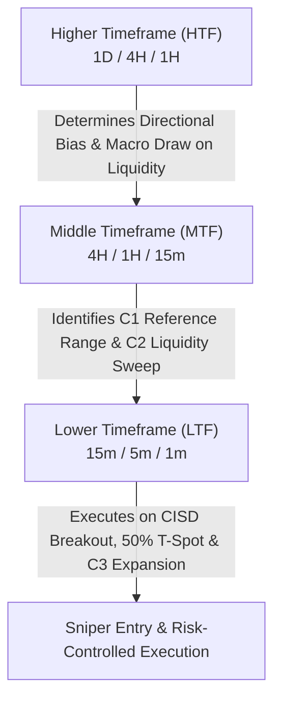

# Chapter 05: Timeframe Alignment & Bias Matrix

> **Core Curriculum** | Previous: [Chapter 04: POI & The T-Spot](04_poi_and_tspot.md) | Next: [Chapter 06: Entry Models Playbook](06_entry_models.md)

---

## 1. Top-Down Alignment Hierarchy

The Fractal Model relies on a strict **3-tier timeframe hierarchy**:

---

## 2. Standard Timeframe Pairing Matrix

To avoid chart clutter and conflicting signals, the indicator provides pre-configured model presets:

| Trading Style / Preset | Higher Timeframe (Bias) | Middle Timeframe (Setup/C2) | Lower Timeframe (Execution/CISD) | Best Session | Typical Holding Time |
| :--- | :--- | :--- | :--- | :--- | :--- |
| **1m - 15m Model (Fast Scalp)** | **1-Hour (1H)** | **15-Minute (15m)** | **1-Minute (1m)** | London Open & NY AM | 15 – 45 minutes |
| **5m - 1H Model (Standard Day)** | **4-Hour (4H)** | **1-Hour (1H)** | **5-Minute (5m)** | London Open & NY AM | 1 – 3 hours |
| **15m - 4H Model (Trend Run)** | **Daily (1D)** | **4-Hour (4H)** | **15-Minute (15m)** | Full Trading Day | 4 – 8 hours |
| **1H - Daily Model (Macro Swing)**| **Weekly (1W)** | **Daily (1D)** | **1-Hour (1H)** | Swing Trades | 2 – 5 days |

!!! warning "The 60:1 Ratio Warning (Why 1m - 1H is Not Recommended for Model 1)"
    Never pair a 1-Hour setup candle (C2) with a 1-Minute chart for Model 1 closed-candle confirmation. By the time 60 minutes elapse for the 1H candle to close, the lower-timeframe move has already hit target liquidity and will retrace or reverse during C3! If you want 1-minute execution, use the **15-minute candle as C2** (`1m - 15m`).

---

## 3. Institutional Killzones & Trading Sessions

Algorithmic liquidity delivery only operates during specific time windows anchored to **New York Time (`America/New_York`)**:

| Session Window | New York Time (EST) | Primary Assets | Algorithmic Characteristic |
| :--- | :--- | :--- | :--- |
| **Midnight Open** | **00:00 NY** | All Assets | Key algorithmic baseline for daily open price delivery |
| **London Open Killzone** | **02:00 – 05:00 NY** | EURUSD, GBPUSD | High probability Asian range sweep & daily low/high formation |
| **New York AM Killzone** | **08:30 – 11:00 NY** | NQ1!, ES1!, Gold | Equities cash open (09:30) volatility & institutional expansions |
| **Key Morning Macro** | **09:50 – 10:10 NY** | Indices & FX | Highest win-rate 20-minute reversal & continuation window |
| **New York PM Killzone** | **13:30 – 16:00 NY** | Indices | Afternoon trend continuation into cash market settlement |

### The Daylight Saving Time (DST) 1-Week Shift
During the 1-week desynchronization period in late October / early November when Europe ends British Summer Time (BST) / Central European Summer Time (CEST) before the United States falls back:

!!! warning "DST Desynchronization Week Shift Rules"
    - **London Killzone in NY Time**: Shifts from 02:00–05:00 to **03:00–06:00 NY Time** (or 03:00–07:00).
    - **London Killzone in East Africa / Ethiopia Time (UTC+3)**: Shifts to **09:00 AM – 12:00 PM local time** (formerly 08:00 AM).
    - **NY AM Cash Open (09:30 NY)**: Opens at **04:30 PM East Africa / Ethiopia Time**.
    - **Indicator Setup**: On TradingView, keep chart timezone set to `UTC-4` (or `America/New_York`) so session boxes and timestamps align automatically.

---

## 4. The "Pro Auto Bias" Engine

In discretionary trading, deciding whether you are bullish or bearish can become subjective. TTrades designed the **Auto Bias** algorithm to remove emotion:

### The Bias Rules:
1. **Bullish Bias Trigger**:
    * The previous HTF candle swept a low and closed **bullish** (Close > Open).
    * Or price closed **above** the high of a previous HTF candle (Expansion run).
    * Under Bullish Bias, the model **only displays Bullish C2 sweeps and Bullish CISD**.
2. **Bearish Bias Trigger**:
    * The previous HTF candle swept a high and closed **bearish** (Close < Open).
    * Or price closed **below** the low of a previous HTF candle (Expansion run).
    * Under Bearish Bias, the model **only displays Bearish C2 sweeps and Bearish CISD**.
3. **Neutral Bias**:
    * Displays all valid setups in both directions (recommended on ranging or consolidation days).

---

## 5. HTF Candle Projection Panel

A distinctive feature of our TradingView indicator is the **HTF Candle Projection cluster** drawn on the right-hand margin of the lower timeframe chart:

Figure 5.1: 15m HTF candle projection cluster rendered directly on the right margin of the 1m execution chart with live countdown timer.

* Renders the last 4 to 10 completed HTF candles directly alongside active LTF price.
* Shows you at a glance:
    * Current HTF candle open line (`showHtfOpen`).
    * Time remaining until the current HTF candle closes (`showHtfTimer`).
    * Day of the week stamps (`showHtfStamps`).

!!! tip "Why This Eliminates Multitasking"
    You never have to leave your 1-minute or 5-minute execution chart to know the exact status, body size, and wick length of the 1-hour or 4-hour candle!
