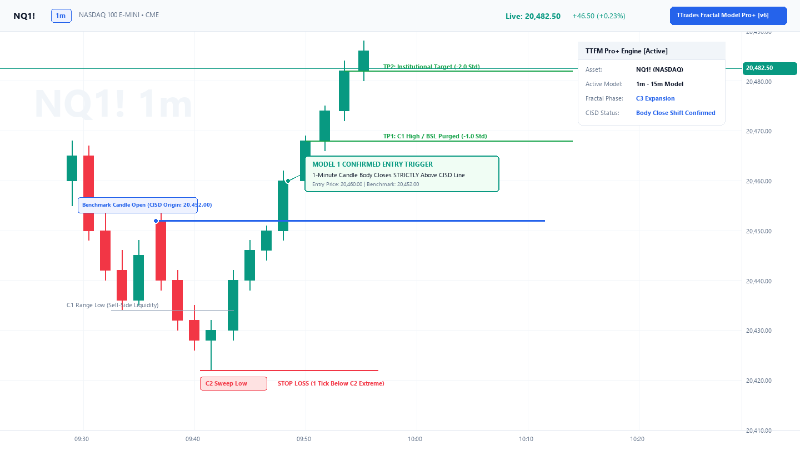
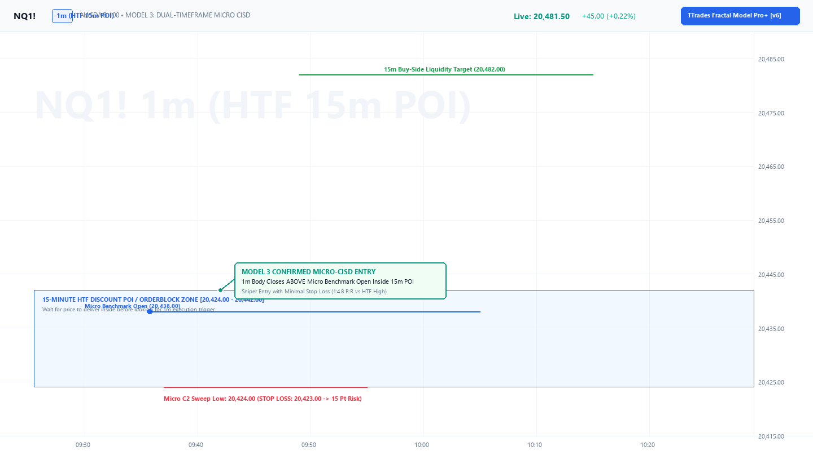

# Chapter 06: Entry Models & Execution Playbook

> **Core Curriculum** | Previous: [Chapter 05: Timeframe Alignment](05_timeframe_alignment.md) | Next: [Chapter 07: Targets & Risk](07_risk_and_targets.md)

---

## 1. Executive Overview & Setup Pre-Conditions

Before looking for an entry trigger, the baseline market structure **must already be confirmed** on your chart:

| Step | Component | Institutional Requirement |
| :--- | :--- | :--- |
| **1** | **C1 Reference Range** | Clear High (Buy-Side Liquidity) and Low (Sell-Side Liquidity) established. |
| **2** | **C2 Liquidity Sweep** | C2 sweeps C1 extreme, taps an HTF POI, and closes back inside the range. |
| **3** | **Directional Bias** | Confirmed via HTF market structure or the indicator's Pro Auto Bias engine. |

Once the `C2` sweep occurs, you are preparing to trade the **expansion** (`C3` or continuation `C4`). Depending on market speed and your personal risk profile, the TTrades Fractal Model provides **Four Distinct Entry Models**.

---

## 2. Model 1: The CISD Body Break & Close (Momentum Confirmation)

> *"I refuse to guess the bottom. I want the algorithm to prove to me that buyers have taken control before I risk capital."*

Figure 6.1: Model 1 Execution showing the candle body close above the blue CISD benchmark line.

### How It Works:
1. **Identify the Benchmark Origin**:
    * The indicator draws a **Blue Horizontal Ray** (for Bullish CISD) originating at the `Open` of the first down-close candle into the C2 low, or a **Red Horizontal Ray** (for Bearish CISD) originating at the `Open` of the first up-close candle into the C2 high.
2. **The Waiting Period**:
    * Even if `C3` opens, if price is still trading below the benchmark line (for longs) or above the line (for shorts), **do not enter yet**. Orderflow has not flipped.
3. **The Exact Trigger**:
    * Watch the 1-minute execution candle approaching the line.
    * Wait for the candle timer to reach `0:00` and for the **candle body to close strictly beyond the CISD line**.
    * A wick piercing the line does **NOT** count. The solid body must close past it.
4. **Order Execution**:
    * **Variant A (Immediate Market Order)**: The exact second the candle body closes across the line, click **Buy/Sell Market**.
    * **Variant B (The Retest Dip)**: Place a limit order on the CISD line. Frequently, the very next candle takes a quick 1–3 tick dip to test the line before launching.
5. **Stop Loss (SL)**:
    * Placed 1–2 ticks beyond the extreme wick tip of **`C2`**.

[Read Full Deep Dive on Model 1 →](../models/model_1_cisd_breakout.md)

---

## 3. Model 2: The 50% T-Spot Limit Entry (Wholesale Discount Hunter)

> *"I refuse to chase green candles. I want to buy at a wholesale discount inside the manipulation wick."*

Figure 6.2: Model 2 Execution showing limit order fill inside the 50% Equilibrium Discount Box.

### How It Works:
1. **The Candlestick Mechanics (AMD / Power of 3)**:
    * 95% of all expansion candles do not move straight to target from the open.
    * A bullish candle first dips *below its open* to form a lower wick (Accumulation $\rightarrow$ Manipulation) before expanding upward (Distribution).
2. **Anatomy of the T-Spot Box**:
    * **Upper Bound**: The **Opening price** of the `C3` candle.
    * **Lower Bound**: The **50% Equilibrium (midpoint)** of the preceding `C2` candle (`[C2 High + C2 Low] / 2`), rendered as the dotted line.
3. **Order Execution**:
    * As soon as `C3` opens and the green T-Spot box appears, place a **Buy Limit Order** sitting on the **dotted line** (or in the upper half of the box).
    * As minute 1, 2, or 3 dips into discount, your limit order gets filled passively.
4. **Stop Loss (SL)**:
    * **Tight Stop**: 1–2 ticks below the dotted line (the bottom of the T-Spot box).
    * **Structural Stop**: Below the lowest wick of **`C2`**.

[Read Full Deep Dive on Model 2 →](../models/model_2_tspot_limit.md)

---

## 4. Model 3: The Micro-Structure Sniper (Dual Timeframe Precision)

> *"I want the wholesale discount of the T-Spot, but I want lower-timeframe confirmation before I click buy."*

Figure 6.3: Model 3 Execution showing a 1m sub-timeframe CISD break inside the 15m HTF T-Spot POI.

### How It Works:
1. You identify a setup on the `5m-1H` or `1m-15m` model.
2. Price enters the shaded **T-Spot Box / HTF Discount POI**.
3. Instead of placing a blind limit order, you zoom into the **1-minute chart inside the box**:
    * Watch for a 1-minute candle to take a tiny internal low (Micro C2).
    * Watch for an immediate 1-minute green candle to close with displacement, printing a micro CISD break.
4. **Order Execution**:
    * Enter Market Long on the close of that micro 1-minute green candle.
5. **Stop Loss (SL)**:
    * Placed strictly below the micro swing low formed inside the box (often just 6–10 points on NQ!).
    * Unlocks astronomical **1:5 to 1:10+ Risk-to-Reward**.

[Read Full Deep Dive on Model 3 →](../models/model_3_micro_cisd.md)

---

## 5. Model 4: The C4 Trend Continuation Entry (The Second Chance)

> *"I was away from my desk when C2 swept and C3 exploded. How do I get into this running trend without buying the top?"*

Figure 6.4: Model 4 Execution showing trend continuation pullback entry during the C4 expansion.

### How It Works:
1. **The Mistake to Avoid**:
    * When `C3` expands 60–100 points, retail traders panic and buy at the very top. Institutional algorithms then initiate a pullback, stopping them out.
2. **The Rule**:
    * Never buy the top of `C3`. **Wait for `C3` to close.**
3. **Anatomy of the `C4` Box**:
    * When `C3` ends, the new candle **`C4`** opens.
    * The indicator automatically draws the **`C4` T-Spot Box**.
    * The dotted line at the bottom is the **50% midpoint of the giant `C3` candle**.
4. **Order Execution**:
    * Price retraces from the high and dips down into the **`C4` green box**.
    * Enter long inside the box (either via limit order or after a 1m green rejection candle).
5. **Targets**:
    * Ride the continuation leg into the final macro standard deviation targets (**`-4.0` / `-4.5`**).

[Read Full Deep Dive on Model 4 →](../models/model_4_c4_continuation.md)

---

## 6. Master Comparison Matrix

| Model | Primary Trigger | Order Type | Confirmation Level | Typical RR | Best Used When... |
| :--- | :--- | :--- | :--- | :--- | :--- |
| **Model 1 (CISD Break)** | Candle body closes past Blue/Red line | Market on Close (or Retest Limit) | **Highest** (Full Body Confirmation) | 1:2 to 1:3.5 | You want zero ambiguity and momentum proof. |
| **Model 2 (T-Spot Limit)** | Price dips into 50% Equilibrium | Limit Order on Dotted Line | **Medium** (Assumes HTF POI holds) | **1:4 to 1:8+** | Clean trending days where you demand a discount. |
| **Model 3 (Micro Sniper)** | 1m FVG / CISD inside T-Spot box | Market on Micro Close | **High** (Multi-timeframe alignment) | **1:5 to 1:10+** | Scalping volatile index futures (NQ/ES). |
| **Model 4 (C4 Continuation)**| Pullback into C4 T-Spot box | Limit or Market inside Box | **Medium** (Trend Continuation) | 1:2 to 1:3 | You completely missed C2 and C3. |
