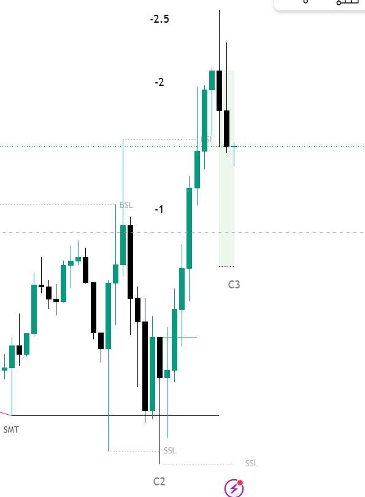

# Chapter 07: Targets, Deviations & Risk Management

> **Core Curriculum** | Previous: [Chapter 06: Entry Models](06_entry_models.md) | Next: [Chapter 08: Indicator Guide](08_indicator_guide.md)

---

## 1. Standard Deviation Projections

A major technical strength of the Fractal Model is its **mathematical price projection engine**. Rather than guessing arbitrary profit targets, TTrades uses **Fibonacci Standard Deviations** anchored to the manipulation swing:

### Anchor Points for Projections:
* **Point "1.0"**: The **C2 Extreme Swing Point** (the tip of the sweep wick).
* **Point "0.0"**: The **CISD Trigger Candle extreme** (the low for bearish, high for bullish).

```pinescript
// Standard Deviation Targets
std_dev_levels = "-1.0, -2.0, -2.5, -4.0, -4.5"
```

```
   [Point 1.0] ════════════════════════════════════ C2 Extreme High (Bearish Sweep)
               \
                \  Manipulation Leg
                 \
   [Point 0.0] ───▼──────────────────────────────── CISD Trigger Low
   
   [-1.0 Std]  ──────────────────────────────────── Target 1: Take 50% Partials (Move SL to BE)
   [-2.0 Std]  ──────────────────────────────────── Target 2: High Probability TP (Close 80%)
   [-2.5 Std]  ──────────────────────────────────── Target 3: Full Delivery / Institutional Objective
   [-4.0 Std]  ──────────────────────────────────── Target 4: Trend Day Runner Extension
```

---

## 2. The Key Target Zones

1. **`-1.0` to `-2.0` (Target 1 - Scale Out)**:
    * 50% of position is closed.
    * Stop Loss is immediately moved to **Break-Even (BE)** or entry price.
2. **`-2.0` to `-2.5` (Target 2 - Institutional Delivery)**:
    * Algorithmic price delivery frequently exhausts between **`-2.0` and `-2.5`**.
    * Take 80–90% off or close the entire trade.
3. **`-4.0` (Target 3 - Mega Expansion)**:
    * Reserved for runners on high-impact news days or strong trend-continuation days.

---

## 3. SMT Divergence: The A+ Setup Qualifier

**SMT (Smart Money Technique) Divergence** is the ultimate institutional confluence in the Fractal Model.

### Visual Anatomy of SMT Divergence
Below is the structural relationship between Nasdaq (NQ) and S&P 500 (ES) during a manipulation sweep:


<div class="image-caption">Figure 7.1: SMT Divergence showing NQ sweeping the C2 low while ES prints a higher low (Institutional Accumulation).</div>

### Real TradingView SMT Chart Example
Here is an authentic capture showing the SMT divergence line plotted directly on the chart alongside the C2 SSL sweep and C3 expansion:


<div class="image-caption">Figure 7.2: Live TradingView indicator chart plotting SMT line, C2 SSL sweep, CISD line, and targets (-1, -2, -2.5).</div>

### Correlated Instruments:
* **Index Futures**: Nasdaq (NQ1!), S&P 500 (ES1!), Dow Jones (YM1!).
* **Forex**: EURUSD vs. GBPUSD; or inverse against the US Dollar Index (DXY).

| SMT Type | Primary Asset (e.g. NQ) | Correlated Asset (e.g. ES) | Institutional Interpretation |
| :--- | :--- | :--- | :--- |
| **Bearish SMT** | Makes a **Higher High** (sweeps liquidity) | Makes a **Lower High** (fails to sweep) | Institutional distribution; ES refuses to go higher $\rightarrow$ **Huge Selloff Expected**. |
| **Bullish SMT** | Makes a **Lower Low** (sweeps liquidity) | Makes a **Higher Low** (fails to sweep) | Institutional accumulation; ES refuses to go lower $\rightarrow$ **Huge Rally Expected**. |

!!! tip "The A+ Qualifier Rule"
    When a C2 sweep coincides with an active SMT divergence, it is classified as an **A+ Setup**. Position size can be traded at full standard risk.

---

## 4. Professional Risk Management Rules

1. **Max 2 Trades Per Day**: If both trades lose, walk away. Your bias or session timing is off.
2. **1% Maximum Account Risk**: Calculate position size based on the distance between your entry price and the C2 extreme stop loss:
    $$\text{Position Size} = \frac{\text{Account Balance} \times 0.01}{\text{Stop Loss Distance in Dollars}}$$
3. **Never Move Stops Away**: Only trail stops toward profit; never widen risk beyond the C2 extreme.
