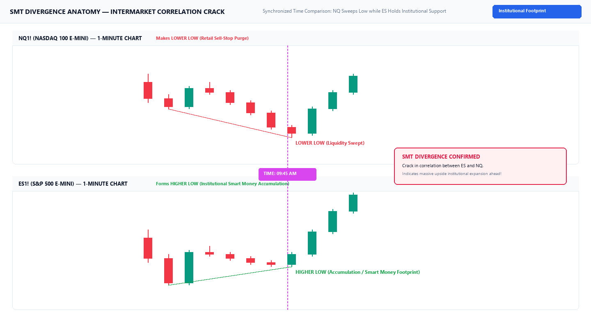

# Chapter 07: Targets, Deviations & Risk Management

> **Core Curriculum** | Previous: [Chapter 06: Entry Models](06_entry_models.md) | Next: [Chapter 08: Indicator Guide](08_indicator_guide.md)

---

## 1. Standard Deviation Projections

A major technical strength of the Fractal Model is its **mathematical price projection engine**. Rather than guessing arbitrary profit targets, TTrades utilizes **Fibonacci Standard Deviations** anchored to the manipulation swing:

### Anchor Points for Projections:
* **Anchor Point 1.0**: The **C2 Extreme Swing Point** (the tip of the sweep wick).
* **Anchor Point 0.0**: The **CISD Trigger Candle extreme** (the swing high for bullish, swing low for bearish).

| Deviation Level | Objective | Order Management Action |
| :--- | :--- | :--- |
| **`0.0 to 1.0`** | Dealing Range Anchor | Manipulation swing leg measurement |
| **`-1.0 Std Dev`** | Target 1 (BSL/SSL Purge) | Take 50% partial profits; move Stop Loss to Break-Even |
| **`-2.0 Std Dev`** | Target 2 (High Probability TP) | Take 80–90% profits; algorithmic delivery objective reached |
| **`-2.5 Std Dev`** | Target 3 (Full Macro Delivery) | Close full position on standard intraday sessions |
| **`-4.0 to -4.5`** | Target 4 (Trend Expansion) | Runner target on high-volatility news or macro trend days |

Below is the photorealistic chart showing standard deviation projections anchored from C2 to C3 and delivered into C4 targets:

Figure 7.1: Fibonacci standard deviation projections (-1.0 and -2.0) plotted accurately from the C2 sweep low to C3 expansion high.

---

## 2. SMT Divergence: The Institutional Footprint

**SMT (Smart Money Technique) Divergence** is the premier institutional confluence in the Fractal Model. It reveals a hidden breakdown in correlation between closely related assets:

### Visual Anatomy of Synchronized SMT Divergence
Below is the photorealistic dual-pane chart showing Nasdaq (NQ) making a lower low while S&P 500 (ES) prints a higher low:

Figure 7.2: Synchronized SMT Divergence — NQ purges retail stops with a lower low while ES forms an institutional higher low.

### Correlated Instruments:
* **Index Futures**: Nasdaq (NQ1!), S&P 500 (ES1!), Dow Jones (YM1!).
* **Forex**: EURUSD vs GBPUSD; or inverse against the US Dollar Index (DXY).

| SMT Type | Primary Asset (e.g. NQ) | Correlated Asset (e.g. ES) | Institutional Interpretation |
| :--- | :--- | :--- | :--- |
| **Bullish SMT** | Makes a **Lower Low** (sweeps liquidity) | Makes a **Higher Low** (fails to sweep) | Institutional accumulation; ES refuses to go lower $\rightarrow$ **Aggressive Upside Expansion**. |
| **Bearish SMT** | Makes a **Higher High** (sweeps liquidity) | Makes a **Lower High** (fails to sweep) | Institutional distribution; ES refuses to go higher $\rightarrow$ **Aggressive Downside Expansion**. |

!!! tip "The A+ Qualifier Rule"
    When a C2 sweep coincides with an active SMT divergence, it is classified as an **A+ Setup**. Position size can be traded at full standard risk with elevated confidence.

---

## 3. Professional Risk Management Rules

1. **Max 2 Trades Per Day**: If both trades lose, walk away. Your bias or session timing is off.
2. **1% Maximum Account Risk**: Calculate position size based on the distance between your entry price and the C2 extreme stop loss:
    $$\text{Position Size} = \frac{\text{Account Balance} \times 0.01}{\text{Stop Loss Distance in Dollars}}$$
3. **Never Move Stops Away**: Only trail stops toward profit; never widen risk beyond the C2 extreme.
