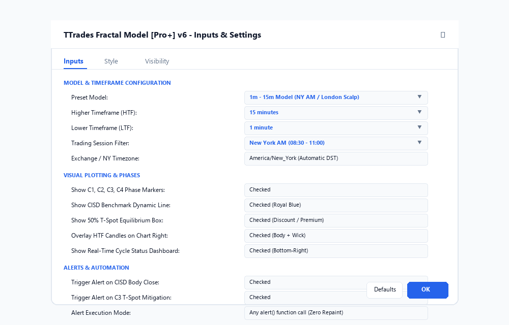
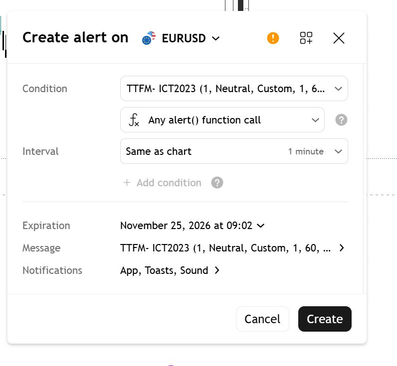

# Chapter 08: TradingView Indicator Setup & Alerts Guide

> **Core Curriculum** | Previous: [Chapter 07: Targets & Risk](07_risk_and_targets.md) | Next: [Entry Models Deep Dive](../models/model_1_cisd_breakout.md)

---

## 1. Indicator Suite Architecture

The repository contains modular **Pine Script v6** indicators engineered for zero repainting and execution clarity:

1. **`fractal_model.pine`**: The complete TTrades Fractal Model [Pro+] v6 indicator (C1-C4 detection, CISD lines, T-Spot boxes, HTF projections, Fibonacci extensions, status dashboard).
2. **`htf_suite.pine`**: Standalone multi-timeframe candle projector displaying 15m, 1H, 4H, and Daily candles on your execution chart.
3. **`fractal_poi.pine`**: Combined Fractal engine with institutional FVG, Orderblock, and Breaker Block detectors.
4. **`liquidity_suite.pine`**: Standalone session liquidity engine plotting Asian, London, and New York session ranges and sweeps.

---

## 2. Step-by-Step TradingView Installation

Follow these simple steps to install the indicator in under 2 minutes:

1. Open your chart on [TradingView](https://www.tradingview.com/).
2. At the bottom of the screen, click the **Pine Editor** tab.
3. If an existing script is open, click **Open** $\rightarrow$ **New indicator**.
4. Open the source file [`scripts/indicators/fractal_model.pine`](https://github.com/DanielKinnito/trading/blob/master/scripts/indicators/fractal_model.pine) in this repository and copy all code.
5. Paste the code into the Pine Editor, replacing any existing template text.
6. Click **Save** and then click **Add to chart**.

---

## 3. Configuring Indicator Settings

Double-click the indicator title on your chart (or click the Gear icon) to access the settings panel:

Figure 8.1: Complete Settings & Inputs panel for TTrades Fractal Model [Pro+] v6.

### Key Settings Breakdown:

| Parameter | Type | Default | Description |
| :--- | :--- | :--- | :--- |
| **Preset Model** | Dropdown | `1m - 15m Model` | Pre-configured HTF and LTF resolutions. Set to `1m - 15m` for 1-minute execution (London Forex/NY Indices) or `5m - 1H` for standard 5m intraday. |
| **Higher Timeframe** | Dropdown | `15` | Higher timeframe used to define C1, C2, and C3 candles. |
| **Show C1-C4 Phases** | Checkbox | `true` | Plots labels `C1`, `C2`, `C3`, `C4` above and below the relevant candles. |
| **Show CISD Line** | Checkbox | `true` | Plots the dynamic blue (bullish) or red (bearish) benchmark trigger line. |
| **Show T-Spot Box** | Checkbox | `true` | Renders the shaded 50% equilibrium box during C3. |
| **Show Dashboard** | Checkbox | `true` | Displays real-time cycle status table in bottom-right corner. |

---

## 4. Setting Up TradingView Alerts (Zero Repaint)

The indicator features native `alert()` integration that triggers instantly on confirmed candle closes:

Figure 8.2: Authentic TradingView alert modal showing Condition set to "TTrades Fractal Model Pro+ [v6]" and "Any alert() function call".

### How to Configure the Alert:
1. Right-click on the chart and select **Add alert...** (or press <kbd>Alt</kbd> + <kbd>A</kbd>).
2. Under **Condition**, select **TTrades Fractal Model Pro+ [v6]**.
3. In the second dropdown directly below Condition, select **`Any alert() function call`**.
4. Under **Interval**, leave it as **Once Per Bar Close**.
5. Under **Notifications**, check:
    - ✓ **Notify in app**
    - ✓ **Show pop-up**
    - ✓ **Play sound**
6. Click **Create**.

!!! tip "Relaxed Monitoring"
    With `Any alert() function call` enabled, you do not need to babysit the chart! The indicator will automatically push an audio and popup alert the moment a candle body closes past the CISD line or price enters the T-Spot.
