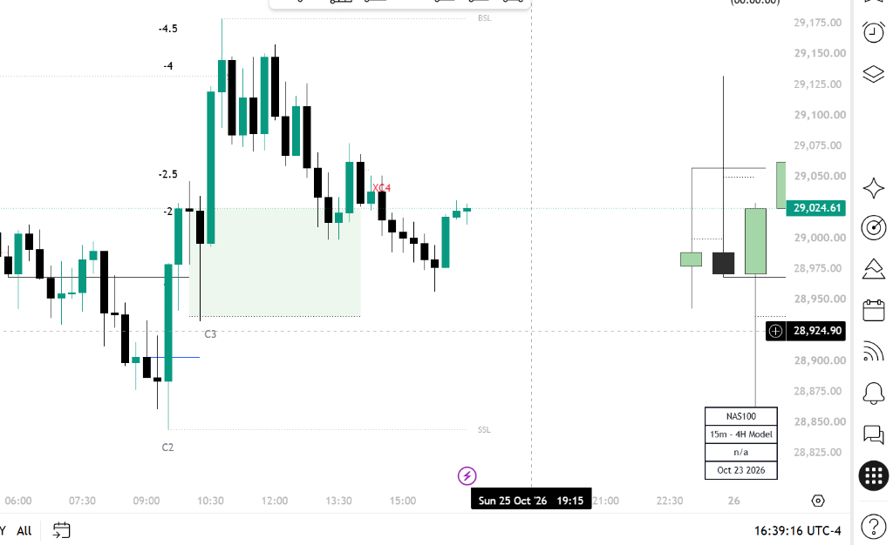

# TTrades Fractal Model & Algorithmic Suite

  <h2 style="margin-top: 0; color: #1e40af; border: none; font-size: 1.6rem;">Algorithmic Multi-Timeframe Price Delivery & Execution Framework</h2>
  

    Welcome to the official documentation and open-source suite for the <strong>TTrades Fractal Model (TTFM)</strong>. Engineered for precision trading on TradingView with strict <strong>Pine Script v6</strong> zero-repainting standards.
  

  

    Pine Script v6 Verified
    Light Mode Optimized
    Zero-Repainting Execution
    Built-in Offline Search
  

---

## The Core Delivery Cycle

Price moves in algorithmic four-phase cycles across all timeframes. Below is the visual anatomy of the complete **C1–C2–C3–C4** sequence that powers every model in this framework:

Figure 1.1: Complete mechanical 4-phase fractal delivery cycle from C1 range to C4 distribution.

---

## Quick Navigation

Explore the core sections of the knowledge base and indicators:

-   :material-school:{ .lg .middle } __Core Curriculum__

    ---

    Step-by-step theoretical and mechanical breakdown from foundations, C1-C4 cycles, CISD mechanics, to multi-timeframe alignment.

    [:octicons-arrow-right-24: Start Learning](curriculum/00_overview.md)

-   :material-crosshairs-gps:{ .lg .middle } __The 4 Entry Models__

    ---

    Detailed execution playbooks with high-resolution visual charts, entry triggers, stop-loss invalidation, and profit targets.

    [:octicons-arrow-right-24: View Entry Models](curriculum/06_entry_models.md)

-   :material-code-tags:{ .lg .middle } __Pine Script Indicators__

    ---

    TradingView v6 indicators: Fractal Model Pro+, HTF Suite, Liquidity Engine, and POI Detectors with zero repainting.

    [:octicons-arrow-right-24: Get Indicators](indicators/quickstart.md)

-   :material-bell-ring:{ .lg .middle } __TradingView Alerts Guide__

    ---

    Step-by-step visual guide on setting up real-time audio, popup, and webhook alerts without chart babysitting.

    [:octicons-arrow-right-24: Setup Alerts](indicators/alerts_guide.md)

-   :material-clock-outline:{ .lg .middle } __Sessions & DST Shifts__

    ---

    Complete reference for London, NY AM, NY PM sessions, key macros (09:50-10:10), and Daylight Saving Time (DST) shift handling.

    [:octicons-arrow-right-24: View Schedule](cheatsheet/sessions_and_rules.md)

-   :material-table-search:{ .lg .middle } __Timeframe Alignment Matrix__

    ---

    Recommended timeframe pairings for scalping, day trading, and swing trading (1m/15m, 1m/1H, 15m/4H, 1H/Daily).

    [:octicons-arrow-right-24: View Matrix](cheatsheet/timeframe_matrix.md)

---

## Real Indicator Visual on TradingView

Here is an authentic capture of the **Fractal Model Pro+** indicator running live on **NAS100 (15m - 4H Model)**, showing the C2 sweep, CISD break, C3 execution, and standard deviation extensions:

Figure 1.2: Real TradingView chart execution showing C2 sweep, C3 entry, C4 extension, and indicator status table.

---

## What Makes This Framework Unique?

!!! tip "100% Rule-Based & Mechanical"
    Unlike discretionary ICT trading where traders debate whether a swing was swept or mitigated, the **Fractal Model provides objective mathematical rules**:
    
    1. **Candle Body Close**: A Change in State of Delivery (CISD) is only confirmed when a candle body closes past the benchmark open price. Wicks alone do NOT count.
    2. **Strict Time Alignment**: HTF context dictates the role of every lower-timeframe candle.
    3. **Automated TradingView Signals**: Zero repaint, unconfirmed live bar protection, and precise alert webhooks.

Use the instant search bar at the top (<kbd>Ctrl</kbd> + <kbd>K</kbd> or <kbd>S</kbd>) to search for any topic, term, or indicator setting!
