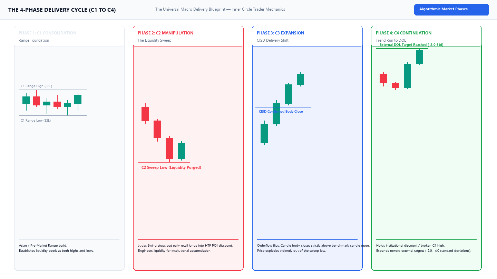
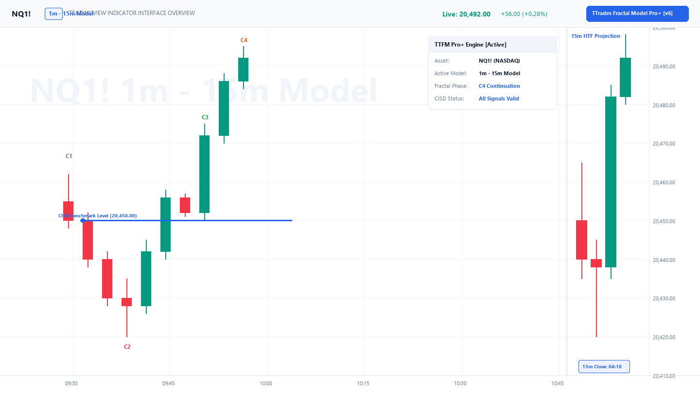

# TTrades Fractal Model & Algorithmic Suite

  <h1 class="tt-hero-title">Algorithmic Multi-Timeframe Delivery & Execution Framework</h1>
  

    The comprehensive technical documentation and open-source indicator suite for the <strong>TTrades Fractal Model (TTFM)</strong>. Engineered for precision orderflow trading on TradingView with strict <strong>Pine Script v6</strong> non-repainting standards and institutional price delivery rules.
  

  

    ✓ Pine Script v6 Native
    Light Mode Optimized
    ✓ 100% Non-Repainting
    Instant Offline Search (Ctrl+K)
  

---

## The Core 4-Phase Delivery Cycle

Market delivery is governed by algorithmic four-phase cycles across all timeframes. Below is the complete anatomical schematic of the mechanical **C1–C2–C3–C4** sequence that underpins every execution model in this framework:

Figure 1.1: Mechanical 4-phase fractal delivery cycle — from C1 range consolidation to C4 institutional expansion.

---

## Materials & Concepts Portal

Explore the curriculum modules, mechanical execution playbooks, and TradingView indicator guides:

  <a href="curriculum/00_overview/" class="tt-card">
    

      

        

          <svg viewBox="0 0 24 24"><path d="M12 3L1 9L12 15L21 10.09V17H23V9M5 13.18V17.18L12 21L19 17.18V13.18L12 17L5 13.18Z"/></svg>
        

        <h3 class="tt-card-title">Core Curriculum</h3>
      

      

        Theoretical foundations, dealing range equilibrium, liquidity classification (ERL vs IRL), and multi-timeframe fractal alignment.
      

    

    

      Start Curriculum →
    

  </a>

  <a href="curriculum/06_entry_models/" class="tt-card">
    

      

        

          <svg viewBox="0 0 24 24"><path d="M12 2C6.49 2 2 6.49 2 12C2 17.51 6.49 22 12 22C17.51 22 22 17.51 22 12C22 6.49 17.51 2 12 2M12 4C16.41 4 20 7.59 20 12C20 16.41 16.41 20 12 20C7.59 20 4 16.41 4 12C4 7.59 7.59 4 12 4M11 6V11H6V13H11V18H13V13H18V11H13V6H11Z"/></svg>
        

        <h3 class="tt-card-title">The 4 Entry Models</h3>
      

      

        High-probability execution playbooks: Model 1 (CISD Breakout), Model 2 (50% T-Spot Limit), Model 3 (Micro CISD Sniper), and Model 4 (C4 Continuation).
      

    

    

      View Playbooks →
    

  </a>

  <a href="curriculum/03_cisd_deep_dive/" class="tt-card">
    

      

        

          <svg viewBox="0 0 24 24"><path d="M16 6L18.29 8.29L13.41 13.17L9.41 9.17L2 16.59L3.41 18L9.41 12L13.41 16L19.71 9.71L22 12V6H16Z"/></svg>
        

        <h3 class="tt-card-title">CISD Deep Dive</h3>
      

      

        Change in State of Delivery mechanics: benchmark candle open origin, orderflow shift validation, and wick rejection vs solid body close rules.
      

    

    

      Master CISD →
    

  </a>

  <a href="indicators/quickstart/" class="tt-card">
    

      

        

          <svg viewBox="0 0 24 24"><path d="M14.6 16.6L19.2 12L14.6 7.4L16 6L22 12L16 18L14.6 16.6M9.4 16.6L4.8 12L9.4 7.4L8 6L2 12L8 18L9.4 16.6Z"/></svg>
        

        <h3 class="tt-card-title">Pine Script Indicators</h3>
      

      

        TradingView Pine Script v6 suite: Fractal Model Pro+, HTF Projection Suite, and POI Detectors with zero-repainting historical execution.
      

    

    

      Get Indicators →
    

  </a>

  <a href="indicators/alerts_guide/" class="tt-card">
    

      

        

          <svg viewBox="0 0 24 24"><path d="M21 19V20H3V19L5 17V11C5 7.9 7.03 5.17 10 4.29V4C10 2.9 10.9 2 12 2C13.1 2 14 2.9 14 4V4.29C16.97 5.17 19 7.9 19 11V17L21 19M14 21C14 22.1 13.1 23 12 23C10.9 23 10 22.1 10 21"/></svg>
        

        <h3 class="tt-card-title">TradingView Alerts</h3>
      

      

        Complete setup guide for real-time sound, push, and webhook notifications on confirmed candle closes so you never have to babysit charts.
      

    

    

      Configure Alerts →
    

  </a>

  <a href="cheatsheet/sessions_and_rules/" class="tt-card">
    

      

        

          <svg viewBox="0 0 24 24"><path d="M12 20C16.4 20 20 16.4 20 12C20 7.6 16.4 4 12 4C7.6 4 4 7.6 4 12C4 16.4 7.6 20 12 20M12 2C17.5 2 22 6.5 22 12C22 17.5 17.5 22 12 22C6.5 22 2 17.5 2 12C2 6.5 6.5 2 12 2M12.5 7V12.25L17 14.92L16.25 16.15L11 13V7H12.5Z"/></svg>
        

        <h3 class="tt-card-title">Sessions & DST Schedule</h3>
      

      

        Reference guide for London Open, NY AM, Key 09:50-10:10 Macros, and Daylight Saving Time (DST) shift adjustments for Forex and Indices.
      

    

    

      View Session Rules →
    

  </a>

---

## Real Indicator Visual on TradingView

Below is an authentic high-resolution chart capture of the **TTrades Fractal Model Pro+ [v6]** running on **NQ1! (1m execution with 15m HTF Projection Cluster)**:

Figure 1.2: Complete indicator layout showing C2 sweep, CISD benchmark ray, live dashboard HUD, and 15m HTF projection candles.

---

## Algorithmic Edge & Mechanical Rules

!!! tip "100% Rule-Based Orderflow Verification"
    Unlike discretionary methods that leave traders guessing whether a swing was swept or mitigated, the **TTrades Fractal Model relies strictly on objective mathematical conditions**:
    
    1. **Candle Body Close**: A Change in State of Delivery (CISD) requires a solid candle body close past the benchmark open price. Wick probes do NOT qualify.
    2. **Origin Accuracy**: The CISD benchmark ray begins strictly at the `Open` of the first opposing candle that initiated the move into the C2 extreme.
    3. **Timeframe Fractality**: Lower timeframe execution models only trigger inside higher timeframe Points of Interest (FVGs, Orderblocks, or Dealing Range Discount).

Use the global search bar (<kbd>Ctrl</kbd> + <kbd>K</kbd>) to search across all concepts, models, and indicator settings instantly!
