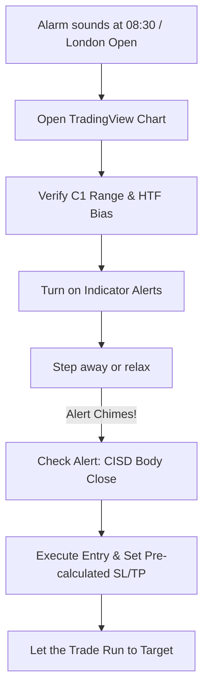

# Complete TradingView Alert Setup Guide

> **Never miss a setup. Learn how to configure real-time audio, mobile push, and webhook alerts with zero repainting.**

---

## 1. Why Our Alerts Never Repaint

Many TradingView indicators trigger "phantom alerts" that fire intrabar and disappear when the candle closes. 

In our suite:
1. Every persistent drawing and alert condition is gated behind **`barstate.isconfirmed`**.
2. Alerts only fire when a candle has completely finished and locked in its final close price.
3. Once an alert triggers, the signal is permanent on historical replay and live charts.

---

## 2. Step-by-Step Alert Configuration

Figure A.1: Correct TradingView alert setup selecting "TTFM- ICT2023" and "Any alert() function call".

### The 4-Step Setup:

1. **Open Alert Window**:
    - Right-click anywhere on your execution chart and select **Add alert...** (or press <kbd>Alt</kbd> + <kbd>A</kbd>).
2. **Select Indicator Condition**:
    - In the top dropdown under **Condition**, select **TTFM- ICT2023** (or `TTrades Fractal Model [Pro+]`).
3. **Select Any alert() function call**:
    - In the secondary dropdown right below Condition, select **`Any alert() function call`**.
    - *(Do not select individual price thresholds; the script automatically handles condition logic via native v6 alert calls)*.
4. **Interval & Expiration**:
    - Set **Interval** to `Same as chart` (e.g. 1 minute).
    - Set **Expiration** to the maximum allowed date.
5. **Notifications**:
    - Enable **Notify in app** (push notifications to iOS / Android TradingView app).
    - Enable **Show pop-up** (on desktop browser).
    - Enable **Play sound** (e.g., chime or alarm).
6. **Click Create**.

---

## 3. What Alerts Will You Receive?

When the alert is active, you will receive notifications for:

- :bell: **`[TTFM] Bullish CISD Confirmed`**: Candle body closed above the benchmark line; entry confirmed.
- :bell: **`[TTFM] Bearish CISD Confirmed`**: Candle body closed below the benchmark line; entry confirmed.
- :bell: **`[TTFM] C3 T-Spot Mitigated`**: Price has wicked into the 50% discount box.
- :bell: **`[TTFM] Target -2.0 Reached`**: Take partial profits and move stop loss to break-even.

---

## 4. Relaxed Chart Monitoring Routine

With alerts enabled, you do **NOT** have to stare at 1-minute candles for hours:

