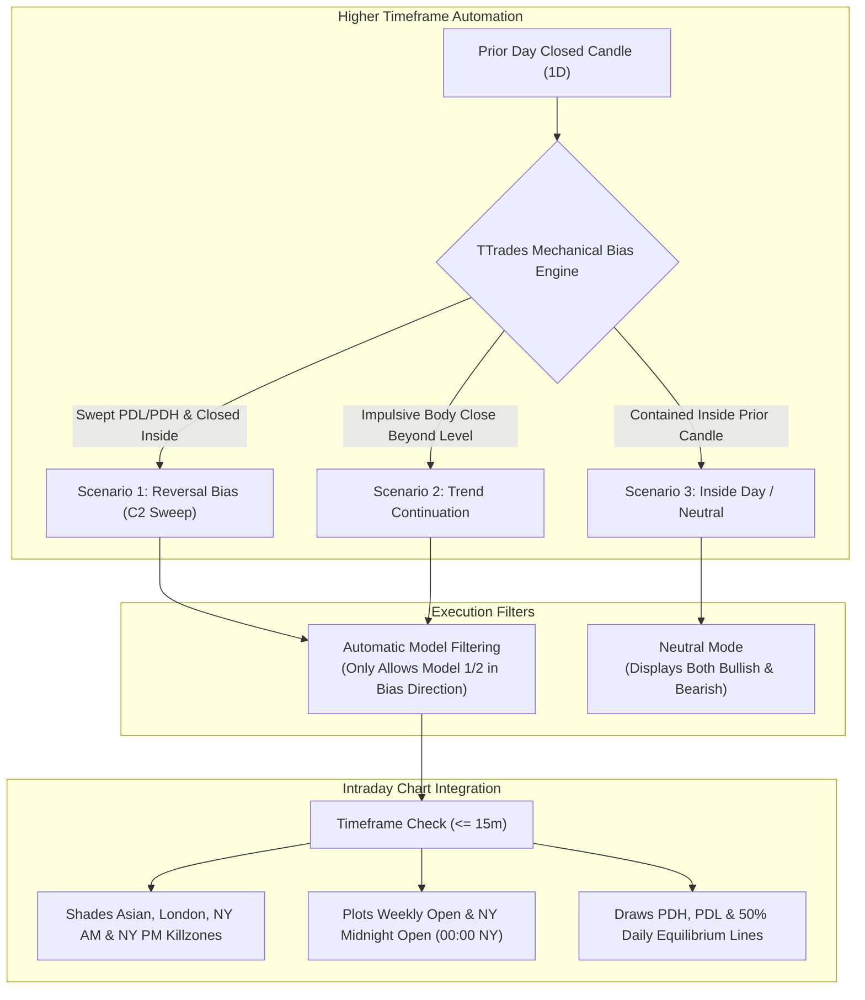

# Fractal Model + Daily Bias & Sessions (All-In-One)

> **Complete TradingView Pine Script v6 Indicator combining TTrades' 4-Phase Fractal Model, Mechanical Auto Daily Bias, ICT Killzones (visible $\le$ 15m), and True Daily/Weekly Opens.**

---

## 1. Indicator Overview

The **Fractal Model with Daily Bias & Sessions** (`fractal_model_daily_bias.pine`) is an enhanced all-in-one suite designed specifically for traders who want full automation of their higher-timeframe narrative. 

Instead of manually analyzing daily charts or second-guessing session direction, the indicator automatically calculates **TTrades' mechanical Daily Bias**, highlights **ICT Killzones** on intraday charts ($\le$ 15m), projects **Weekly and Daily Midnight Opens**, and monitors **Previous Day High/Low (PDH/PDL)** sweeps.

---

## 2. Key Added Features

### A. Mechanical Auto Daily Bias Engine
* Eliminates discretionary guesswork by applying TTrades' rulebook to yesterday's closed daily candle (`lookahead = barmerge.lookahead_off` with historical closed bar offsets `[1]` and `[2]`).
* **Bullish Bias**:
  * Prior day swept the Previous Day Low and closed back inside (C2 Turtle Soup), or
  * Prior day closed with an impulsive body above the prior day's high (C3/C4 expansion).
* **Bearish Bias**:
  * Prior day swept the Previous Day High and closed back inside (C2 Turtle Soup), or
  * Prior day closed with an impulsive body below the prior day's low (C3/C4 expansion).
* **Automatic Setup Filtering**: When `Auto Daily` bias is Bullish, the indicator automatically suppresses bearish setups so you never trade against institutional orderflow!

### B. ICT Killzones (Visible $\le$ 15m Only)
* Intelligently appears only on execution charts at or below 15 minutes (`tf_min <= 15`), keeping higher timeframes (1H, 4H, Daily) completely clean.
* Highlights all 4 institutional windows (anchored to **`America/New_York`**):
  * **Asian Range**: 20:00 – 00:00 NY Time
  * **London Killzone**: 02:00 – 05:00 NY Time
  * **NY AM Killzone**: 08:30 – 11:00 NY Time
  * **NY PM Killzone**: 13:30 – 16:00 NY Time
* Includes optional clean text labels at the beginning of each session.

### C. Weekly & Daily Opens (Institutional Reference Levels)
* **Weekly Open (`W.Open`)**: Marked at the weekly open and stays persistent across the entire trading week.
* **NY Midnight Open (`00:00 NY`)**: The algorithmic baseline for daily true open price delivery.
* **Start-of-Day Line**: A crisp vertical line separating daily trading cycles at 00:00 NY.
* **PDH / PDL / Daily EQ Lines**: Plots Previous Day High, Previous Day Low, and the 50% Equilibrium line across the active day.

---

## 3. Input Settings Reference

| Category | Input Setting | Type | Default | Description |
| :--- | :--- | :--- | :--- | :--- |
| **TTrades Daily Bias** | `biasMode` | Dropdown | `Auto Daily` | `Auto Daily` (calculated automatically), `Manual`, or `Neutral`. |
| **TTrades Daily Bias** | `biasManual` | Dropdown | `Neutral` | Manual directional override when `Manual` mode is selected. |
| **TTrades Daily Bias** | `showBiasLevels` | Boolean | `true` | Plots dynamic PDH, PDL, and 50% Daily Equilibrium lines. |
| **ICT Killzones** | `show_kz_shading` | Boolean | `true` | Enables background color shading for killzones. |
| **ICT Killzones** | `kz_max_tf` | Integer | `15` | Shading and labels only show on charts $\le$ this number of minutes. |
| **ICT Killzones** | `show_asian` | Boolean | `true` | Asian Range (20:00 – 00:00 NY Time). |
| **ICT Killzones** | `show_london` | Boolean | `true` | London Killzone (02:00 – 05:00 NY Time). |
| **ICT Killzones** | `show_nyam` | Boolean | `true` | New York AM Killzone (08:30 – 11:00 NY Time). |
| **ICT Killzones** | `show_nypm` | Boolean | `true` | New York PM Killzone (13:30 – 16:00 NY Time). |
| **ICT Opens** | `show_mno` | Boolean | `true` | New York Midnight True Daily Open line. |
| **ICT Opens** | `show_wo` | Boolean | `true` | Weekly Open line (remains visible until next week). |
| **ICT Opens** | `show_day_vline` | Boolean | `true` | Vertical line dividing days at 00:00 NY. |

---

## 4. Installation & Code Location

The complete, self-contained Pine Script v6 source file is located in the repository at:

[`scripts/indicators/fractal_model_daily_bias.pine`](https://github.com/DanielKinnito/trading/blob/master/scripts/indicators/fractal_model_daily_bias.pine)

### Installation Steps:
1. Open [`scripts/indicators/fractal_model_daily_bias.pine`](file:///c:/Projects/trading/scripts/indicators/fractal_model_daily_bias.pine) and copy the entire script.
2. In TradingView, open the **Pine Editor** tab at the bottom of your chart.
3. Click **Open** $\rightarrow$ **New indicator**, paste the code, and click **Save**.
4. Click **Add to chart**.
5. Switch to a **1m** or **5m** chart: the Killzones, Daily Open, Weekly Open, and Auto Daily Bias will render automatically!
