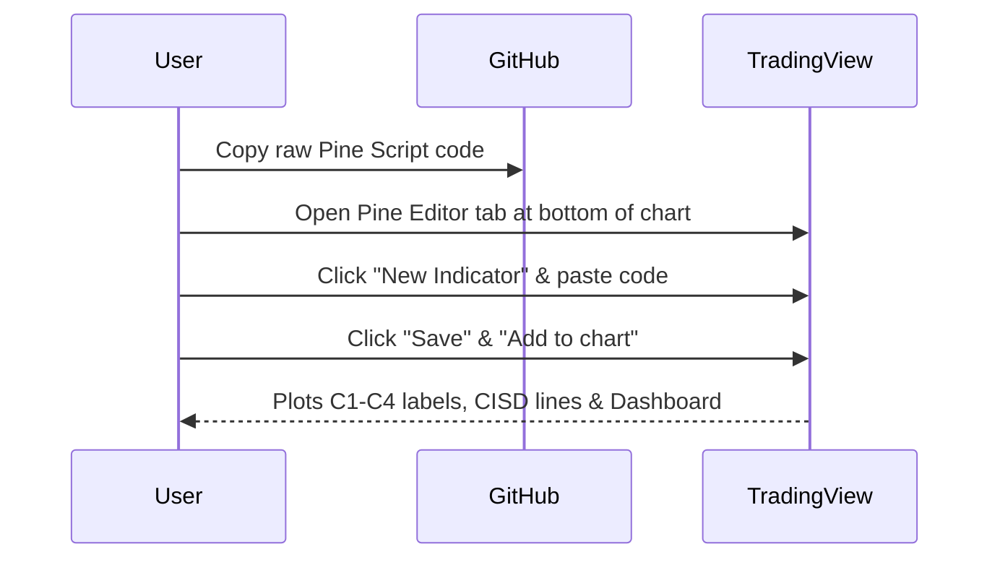
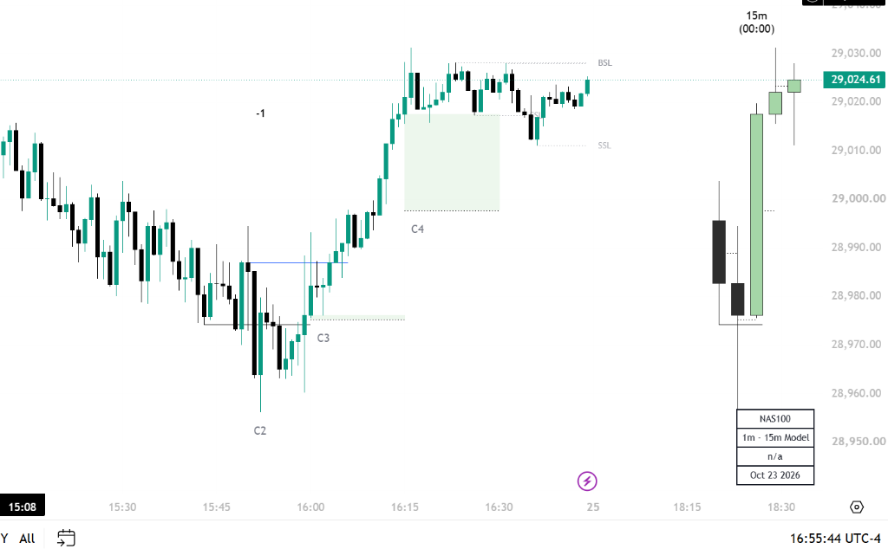

# Indicator Suite Quickstart

> **Get the indicator suite up and running on your TradingView charts in under 3 minutes.**

---

## 1. Prerequisites

- A free or paid [TradingView account](https://www.tradingview.com/).
- Google Chrome, Brave, Safari, or the TradingView Desktop app.

---

## 2. Pine Script v6 Scripts in This Repository

This repository includes four modular indicators located in [`scripts/indicators/`](https://github.com/DanielKinnito/trading/tree/main/scripts/indicators):

| Script | Filename | Purpose |
| :--- | :--- | :--- |
| **Fractal Model [Pro+]** | [`fractal_model.pine`](fractal_model.md) | Complete 1:1 recreation of the TTrades 4-phase fractal model with CISD and T-Spot. |
| **HTF Suite** | [`htf_suite.pine`](htf_suite.md) | Multi-timeframe candle projector with open lines and timers. |
| **Liquidity Suite** | [`liquidity_suite.pine`](liquidity_suite.md) | Standalone session ranges (Asia, London, NY) and liquidity sweep detector. |
| **Alerts Guide** | [Alerts Guide](alerts_guide.md) | How to configure zero-repaint audio and webhook alerts. |

---

## 3. Quick Installation Walkthrough

1. Navigate to the indicator source page (e.g., [Fractal Model Pro+](fractal_model.md)).
2. Click the **Copy Code** button in the top right of the code block.
3. Open TradingView, open the **Pine Editor** at the bottom, paste the code, and click **Add to chart**.

---

## 4. Default Visual Layout

Once loaded, the indicator renders:
- Solid blue/red **CISD dynamic benchmark lines**.
- Shaded green/red **T-Spot equilibrium boxes**.
- Real-time **Dashboard Table** in the bottom-right corner.
- Right-hand margin **Higher Timeframe Candle Projection**.

Figure I.1: Clean light-mode TradingView chart running Fractal Model Pro+.

