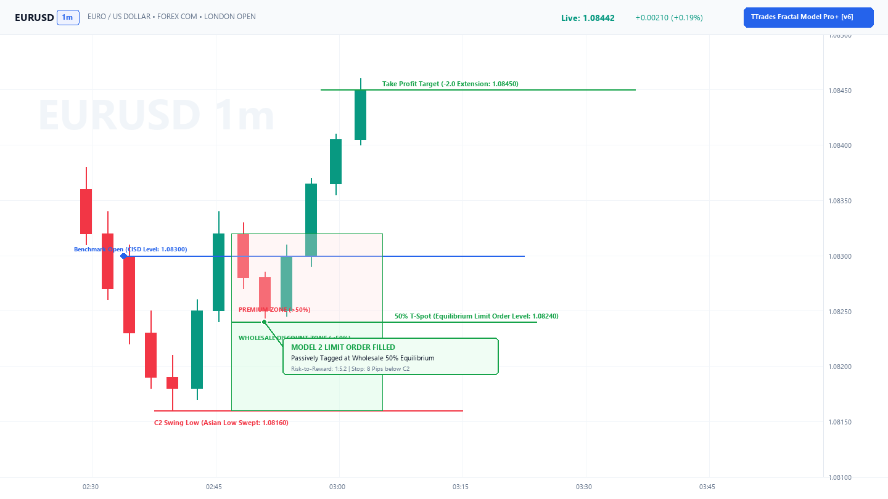
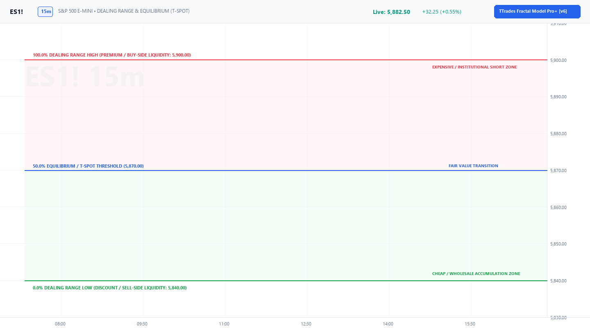

# Model 2: T-Spot Equilibrium Limit Entry

Maximum Risk-to-Reward
Limit Order Style
RR: 1:4 to 1:8+

> *"I refuse to chase green candles. I want to buy at a wholesale discount inside the manipulation wick."*

---

## Visual Setup Schematic

Below is the photorealistic chart breaking down Model 2 execution with passive limit fill at the wholesale 50% T-Spot equilibrium:

Figure M2.1: Complete anatomical breakdown of Model 2 limit execution inside the 50% Equilibrium Discount Box.

---

## 1. What You See on the Indicator

When running the **Fractal Model Pro+ [v6]** indicator with `showTSpot = true`:

1. **C2 Sweep Completed**: The C2 manipulation candle finishes its sweep.
2. **C3 Opens**: A shaded box appears projecting forward:
    - **Top of Box**: Opening price of C3.
    - **Dotted Center Line**: Exact **50.00% Equilibrium** of the C2 manipulation swing (`[C2 High + C2 Low] / 2`).
    - **Bottom of Box (Bullish)**: Wholesale discount zone boundary.
3. **Dashboard State**: Bottom-right HUD displays `C3 T-Spot Active`.

---

## 2. Step-by-Step Execution Rules

### Bullish Execution:
1. **Pre-condition**: C2 has closed as a valid sweep, and HTF bias is bullish.
2. **The Box Appears**: At the opening bell of C3 (e.g. at 09:30 or on the hourly open), the green T-Spot box projects forward.
3. **Place the Limit Order**:
    - Place a **Buy Limit Order** sitting directly on the **dotted line (50% Equilibrium)**.
4. **Passive Fill**:
    - Minutes 1–3 of the new candle drop downward to form the lower manipulation wick.
    - Price dips into discount, tags your limit order, and absorbs institutional liquidity.
5. **Stop Loss (SL)**:
    - **Tight Stop**: 1–2 ticks below the dotted equilibrium line (or bottom of the box).
    - **Structural Stop**: Below the lowest wick tip of **C2**.
6. **Take Profit (TP)**:
    - Target the **`-2.0` and `-2.5` Fibonacci Standard Deviation levels**.

---

## 3. Dealing Range Equilibrium Mechanics

Below is the photorealistic chart showing how the 50.00% equilibrium separates institutional discount accumulation from premium distribution:

Figure M2.2: Dealing Range 50% equilibrium threshold separating discount buy-programs from premium sell-programs.

---

## 4. Pros & Cons of Model 2

!!! tip "Incredible Risk-to-Reward"
    Because your stop loss is anchored to a discount level rather than a breakout high, your stop distance is often 50–70% smaller than Model 1. This allows substantially higher position sizing while keeping absolute risk fixed at 1%!

!!! warning "Missed Fill Risk"
    On ultra-violent trend days, price may only dip 2–3 ticks into the box before rocketing, leaving your limit order unfilled. If this happens, **do not chase**; wait for Model 4!
