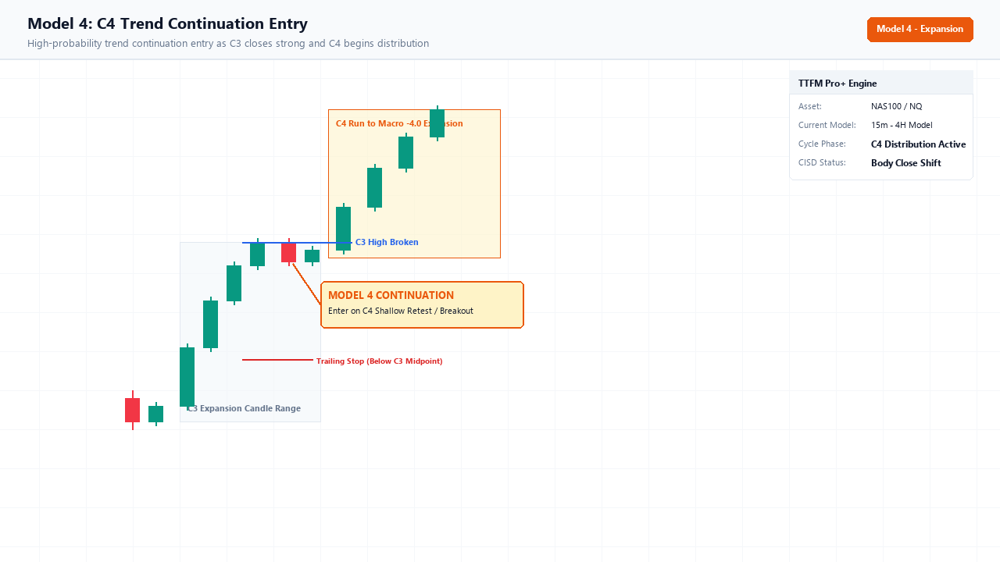

# Model 4: C4 Trend Continuation Entry

Continuation Style
Anti-FOMO Framework
Target: -4.0 Macro Extension

> *"I was away from my desk when C2 swept and C3 exploded. How do I get into this running trend without buying the top?"*

---

## Visual Setup Schematic

Figure M4.1: Model 4 execution showing shallow pullback and continuation during the C4 expansion.

---

## 1. What You See on the Indicator

Model 4 is designed to prevent traders from FOMO buying at the peak of an explosive move:

1. **C3 Closes Strong**: A massive green displacement candle closes near its high.
2. **C4 Opens**: The indicator places a label `C4` above the new candle and projects the **`C4` Continuation Box**.
3. **Midpoint Dotted Line**: Represents the **50.00% Equilibrium of the preceding C3 candle**.
4. **Dashboard State**: Bottom-right table displays `C4 Trend Distribution`.

---

## 2. Step-by-Step Execution Rules

### Bullish Execution:
1. **The Mistake to Avoid**:
    - Never buy at the peak of C3. **Wait for C3 to close.**
2. **The Pullback**:
    - When C4 opens, price naturally pulls back as algorithms rebalance early longs.
    - Price dips into the **C4 continuation box**.
3. **The Trigger**:
    - Enter long as price tests the top of the C3 range or the 50% midpoint of C3.
    - Alternatively, enter on the close of the first 1m green candle that rejects the C4 box.
4. **Stop Loss (SL)**:
    - Placed 1–2 ticks below the **50% midpoint dotted line of C3** (or below the C4 pullback wick).
5. **Take Profit (TP)**:
    - Target the **`-4.0` and `-4.5` Macro Standard Deviation extensions**.

---

## 3. Real TradingView Chart Example

Here is an authentic capture showing the C4 expansion on NAS100 running into the -4.0 and -4.5 extensions:

Figure M4.2: NAS100 live chart showing C4 continuation running to -4.0 and -4.5 macro targets.

---

## 4. Invalidation & Common Mistakes

!!! danger "Do Not Trade Model 4 If C3 Wicks Extensively"
    If C3 closes with a giant upper wick (indicating heavy institutional selling), **do NOT trade Model 4**. Model 4 is ONLY valid when C3 closed with a massive, dominant solid body!
